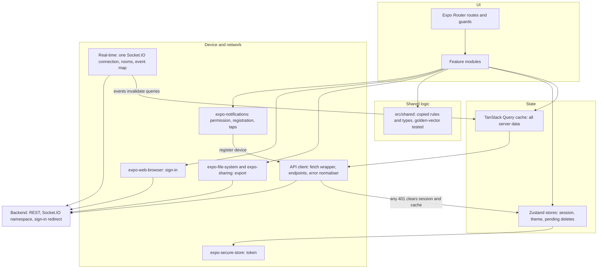
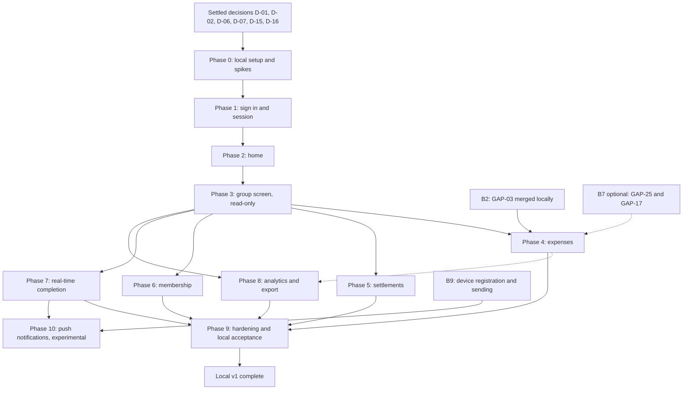

# Split Money mobile app — master plan

2026-10-12, revised 2026-10-19 for local-only use and the owner's decisions · Inputs: [split-money-srs.md](split-money-srs.md) (requirements) and [mobile-stack-decision.md](mobile-stack-decision.md) (agreed stack, rules, risks, prerequisites).

Requirement, gap and scenario IDs (FR-*, BR-*, NFR-*, GAP-*, AT-*, SC-*) point into the SRS. "Decision record" means the stack decision. In this plan, backend prerequisites are B1 to B7 and ranked risks are R1 to R7, numbered exactly as the decision record orders them.

**Run mode: local only.** The backend runs in Docker on the developer's Mac and the app runs in the iOS Simulator as a development build made on the Mac, talking to that backend. Nothing is built for, signed for or submitted to a store. Everything that exists only to distribute the app is collected in section 15 and is out of scope until the app leaves this machine.

## 1. Summary

- **What**: a native iOS and Android client for Split Money at functional parity with the reference web client (SRS sections 5 to 10 and 13), built from the SRS alone as a clean start, plus an experimental push-notification phase.
- **Where it runs**: backend and database in the repo's Docker dev stack on this Mac; the app in the iOS Simulator as a development build compiled locally with Xcode. iOS first; Android later (D-15).
- **Stack**: React Native on Expo SDK 58 (npm `latest` is 58.0.16 on 2026-10-19), strict TypeScript, Expo Router, TanStack Query, Zustand, socket.io-client, expo-notifications, Jest, Maestro. Development builds made with `npx expo run:ios`; no Expo Go, no EAS, no store builds.
- **Phases**: eleven. Phase 0 (local setup and spikes), Phases 1 to 8 (one per SRS 17.1 step, same numbers), Phase 9 (hardening and a full local acceptance run), Phase 10 (push notifications, experimental).
- **Backend work**: B2 (the GAP-03 fix, already committed on a local branch) before Phase 4, and B9 (device registration and notification sending) before Phase 10. Everything that protects a distributed app is deferred to section 15.
- **Decisions**: D-01, D-02, D-06, D-07 and D-15 to D-18 are settled (section 3), so Phase 0 can start. The four still open (D-08, D-09, D-11, D-13) block later phases only.

## 2. Goals, scope and non-goals

**Goal.** A member can do in the app, running in the simulator against the local backend, everything the reference client lets them do, and the two clients produce identical server state for AT-01 to AT-25.

**Parity target.**

| SRS section | In v1 |
| --- | --- |
| 5 Authentication | Client behaviour FR-AUTH-01 to 15 with Google sign-in in the iOS Simulator, plus a development-only email sign-in for Maestro and for targets where Google cannot complete (section 10.4) |
| 6 Groups, membership, guests | All of FR-GRP-01 to 21 |
| 7 Expenses | FR-EXP-01 to 22; FR-EXP-23 replaced by date preservation (GAP-11) |
| 8 Balances and settlement | FR-BAL-01 to 04, FR-SET-01 to 23 and 25; FR-SET-24 not exposed |
| 9 History, analytics, export, summary | FR-HIS-01 to 12, FR-ANA-01 to 10, FR-EXP-X4, FR-SUM-01 and 02 |
| 10 Real-time | FR-RT-01 to 10 |
| 11 Calculation rules | Client-side rules only: BR-1 to BR-9, BR-12, BR-13, BR-16 to BR-19, BR-23 to BR-25 |
| 13 Client behaviour | SC-01 to SC-11, global elements 13.2, loading map 13.6, states 13.8, fixed lists 13.9 |
| 14 Non-functional | NFR-10, 16, 22, 23, 25 to 27, 29 to 32 as client requirements |
| 15 Error catalogue | Every listed client reaction |

**Additions beyond parity**: the development-only email sign-in (section 10.4), an Account screen for sign-out and theme, the mobile rules in section 4.5, and push notifications as an experiment (Phase 10, proposed requirements FR-PUSH-01 to 08).

**Out of v1**: everything in section 15 (store builds, Apple sign-in, account deletion, the sign-in hardening of GAP-01 and GAP-02, verified https links, rate limiting); offline entry (NFR-22); per-currency minor units (GAP-13); ownership or approval rules (GAP-04); settlement edit or reversal (GAP-20); localisation (NFR-25); group-wide settle-up (FR-SET-24); exchange rates (FR-FX-01 to 03); tablet-specific layouts (Q-09).

**Done for v1 means**: AT-01 to AT-25 pass in the iOS Simulator against the local Docker backend at the layers in section 9.4; all fourteen SRS 17.2 contract items hold; B2 is merged into the local backend; the local acceptance checklist in section 10.7 is complete. Android runs are not part of v1 "done" (D-15). Phase 10 is an experiment: v1 is done whether it ends with working local push or with written findings.

## 3. Decisions

Settled decisions are recorded with who made them on 2026-10-19 (D-17 and D-18 on 2026-10-23). Open ones still carry a recommendation and the phase they block. Decisions that only matter for distribution (former D-04, D-05, D-10, D-12, D-14) are in section 15.

### 3.1 Settled

| ID | Decision | Outcome | Decided by |
| --- | --- | --- | --- |
| D-01 | Directory and repo placement | A new git repo, added as a third submodule at `money-split-native/`. It must not collide with the existing `money-split-mobile` directory, which this plan does not read or build on. | Owner: approved |
| D-02 | App name, URL scheme, identifiers | Display name "Split Money"; URL scheme `splitmoney`; iOS bundle identifier and Android package `com.minhduc0400.splitmoney`, from the owner's GitHub handle so it is unique. Local only: nothing is registered with Apple or Google. Revisit before any distribution (section 15). | Owner delegated; planner |
| D-03 | Minimum OS versions | SDK 58 defaults. Nothing ships to users. | Default |
| D-06 | Push notifications | In, as an experiment: Phase 10. | Owner: "try push notifications" |
| D-07 | Offline expense entry | Out. The owner did not ask for it and the API has no sync model (NFR-22). | Default, not raised by the owner |
| D-15 | Targets | iOS first: the iOS Simulator is the only target for v1. Android is added after v1 (needs Android Studio and a JDK, not installed today). | Owner: "iOS first" |
| D-17 | Apple Developer Program membership for real push | None. Phase 10 uses simulated pushes only (tier 1); real APNs delivery (tier 2) moves to section 15. | Owner: no |
| D-18 | Notification content | As proposed in Phase 10: who did what, including the amount, shown on the lock screen. | Owner: yes |
| D-16 | Expo Go or a development build | A development build from Phase 0, compiled on the Mac with `npx expo run:ios`. Push (D-06) needs the app's own bundle identifier, which Expo Go cannot give. It also gives the app its own `splitmoney://` URLs for sign-in and invite links. A simulator build needs no Apple account and no EAS; Xcode 26.4.1 is installed. | Owner delegated; planner |

### 3.2 Open

| ID | Decision | Options | Recommendation and reason | Blocks | Default if undecided |
| --- | --- | --- | --- | --- | --- |
| D-08 | Invite links | (a) the app handles `splitmoney://join/<code>`, tested with `xcrun simctl openurl`; (b) code entry only | (a). FR-GRP-10 and AT-21 need it. Verified https links need a public domain and are deferred (B3, section 15). | Phase 6 | (a) |
| D-09 | Expense date field (GAP-11) | (a) date field, default today, preserved on edit; (b) no field, original date preserved on edit | (a). 17.2 already requires preserving the date; the field is a small addition to step 1 of the form. | Phase 4 | (b), the minimum 17.2 allows |
| D-11 | Token lifetime while developing (FR-AUTH-07) | Keep 7 days; lengthen `JWT_EXPIRES_IN` in `.env.docker.dev` | Lengthen locally (for example 30 days) to avoid weekly re-sign-in during development. It also affects the local web client. | Phase 1 | 7 days |
| D-13 | Open member permissions (GAP-04) | Parity; add confirmations or restrictions | Parity. No approval model exists server-side. Settle-up (FR-SET-24) is not exposed. | Phase 4 | Parity |

## 4. Architecture

The app is a thin view over the backend: server data lives only in the query cache, three small stores hold what must exist outside React, and socket events do nothing except invalidate queries.

### 4.1 Layers



### 4.2 Modules

| Module | Holds | SRS source |
| --- | --- | --- |
| Routes | Navigation tree, auth guard, `auth/callback` guard, deep-link entry | FR-AUTH-15, FR-GRP-10 |
| Features | `auth`, `home`, `group` (overview, members, analytics tabs), `expenses`, `settlements`, `membership`, `export`, `account`; each owns its screens, queries and mutations | Sections 5 to 9, 13 |
| Shared logic (`src/shared`) | Copied unchanged from the web client. The decision record counts 482 lines of logic and 298 of types; `lib/accounting.ts`, `lib/currency.ts`, `lib/chartSlices.ts`, `lib/memberColors.ts`, `expense-form/stepValidation.ts` and `types/*.ts` add up to exactly those figures. Confirm the list in Phase 0. | Section 11, 13.9 |
| API client | Bearer header, idempotency-key helper, error normaliser (`message` string or array joined), numeric-string parsing at the boundary (GAP-23), the 401 path | Section 12, 15 |
| Real-time | One connection per session, `join_group` and `leave_group`, re-join on reconnect, event-to-query map | Section 10 |
| Notifications | Permission request, device registration and removal, foreground presentation rule, tap routing to the group (Phase 10) | Proposed FR-PUSH-01 to 08 |
| Storage | Token in expo-secure-store (NFR-10). Session user is rebuilt from the token (FR-AUTH-11). Theme and the pending invite code (10-minute life) are small non-secret values; see Q-05. | SRS 13.7 |

### 4.3 How server state, client state and events interact

- **Reads** are queries keyed by group and view, following the loading map in SRS 13.6. History is an infinite query over the cursor (FR-HIS-02).
- **Writes** are mutations. On success they invalidate the queries SRS 13.6 lists for that action. Creates and settlements carry an idempotency key created per user action and reused only on retry (NFR-16, BR-19).
- **Events** map to invalidations per the table in SRS 10.3. The app's own echo (FR-RT-08) causes one more harmless refetch. An event that arrives before its transaction commits (GAP-27) yields a refetch with no change; the next foreground or event corrects it.
- **History and events**: an event that arrives while a next page is loading defers the first-page invalidation until that load ends (FR-HIS-11). Whether invalidation refetches every loaded page is unverified in the decision record and is settled by the Phase 3 spike.
- **Settlement plan**: one source for both the plan cards and settle-all, the server's `GET /groups/:groupId/settlements`, grouped by pair on the client. This follows GAP-19 and SRS 2.4 and departs from the letter of FR-SET-03; see Q-01.
- **Client state**: session (token, user), theme, pending deletes. Nothing else. The active group is the route parameter.

### 4.4 Error and 401 path

1. The fetch wrapper turns every non-2xx into one error shape: status plus a display string (arrays joined).
2. **401 from any call** (FR-AUTH-13): cancel pending deletes, clear secure storage, clear the query cache, close the socket, reset stores, show SC-01. The same routine serves manual sign-out.
3. Specific reactions come from SRS section 15: 403 "not a member" leaves the group screen and reloads the group list; 404 on a group shows "Group Not Found"; 409 "already a member" opens the group; 409 "already being processed" waits and refetches without a new key; a 500 on expense edit or delete reloads and retries once (GAP-17); settle-all 400s reload balances and reopen the dialog.
4. Everything else shows the server's `message` text as written (SRS 13.8).

### 4.5 Mobile-specific rules

| Rule | Statement | Source |
| --- | --- | --- |
| Undo-delete on backgrounding | When the app leaves the foreground, send every pending delete at once; undo ends there. A 404 counts as success. On failure, restore the row and show the error on return. Signing out cancels pending deletes. | Decision record rule; FR-EXP-15 |
| Refetch on foreground | Returning to the foreground reconnects the socket, re-emits `join_group` and refetches the visible group's queries. | FR-RT-06, FR-RT-09, 17.2 |
| Deep links | `/join/<code>` opens SC-03 from a cold or warm start, signed in or not. Signed out, the code is stored with a timestamp and auto-joined after sign-in within 10 minutes. Locally the link is the app's own URL, `splitmoney://join/<code>`, opened with `xcrun simctl openurl booted <url>`. Verified https links are deferred (section 15). | FR-GRP-10, D-08 |
| Secure storage | The token is written only to expo-secure-store, never to plain preferences or logs. | NFR-10 |
| `auth/callback` guard | The route accepts a result only while a sign-in is pending; at any other time it is ignored. Locally the redirect is the app's own URL, `splitmoney://auth/callback`, which the backend accepts without an allow-list (GAP-01). That is acceptable only while nothing leaves this machine; section 15 restores the allow-list. | Decision record; GAP-01 |
| Notifications | Ask for permission only after the user has a group, never at first launch; a refusal is respected and never re-asked automatically. A tap opens the group from a cold or warm start. While that group is on screen, its notifications are not shown, because the socket already refreshes it. | Proposed FR-PUSH-01, 07 |
| No web-only assumptions | Dialogs become modal routes; "tap outside to dismiss" becomes the platform's dismiss gesture; dialog actions stay disabled while a request runs. | SRS 13.5 |

### 4.6 Navigation tree

Route names are proposals; each phase's design check fixes them. Screen IDs are from SRS 13.1.

| Route | Screen | Access | Phase |
| --- | --- | --- | --- |
| `sign-in` | SC-01 Sign in (Google; development email sign-in when enabled; no Apple button) | Signed out only | 1 |
| `auth/callback` | SC-02 Sign-in return | Only while a sign-in is pending | 1 |
| `join/[code]` | SC-03 Invite landing | Public and signed in | 6 |
| `(app)/home` tab | SC-04 Home (Overview) | Signed in | 2 |
| `(app)/groups` tab | SC-05 Groups list | Signed in | 2 |
| `(app)/account` tab | Account: avatar, sign out, theme (SRS 13.2; no SC ID) | Signed in | 2 |
| `group-action` modal | SC-06 Create or join | Signed in | 2 (create), 6 (join) |
| `group/[groupId]` | SC-07 Group: Overview, Members, Analytics tabs | Member | 3, 6, 8 |
| `expense/new` modal | SC-08 Add expense (group picker, four steps) | Signed in, one group or more | 4 |
| `group/[groupId]/expense/[expenseId]` modal | SC-09 Edit expense | Member | 4 |
| `group/[groupId]/settle` modal | SC-10 Record payment | Member | 5 |
| `group/[groupId]/settle-all` modal | SC-11 Settle all | Member | 5 |

The older "quick summary" screen (SRS 13.1) is not built.

## 5. Workstreams

| Workstream | Owner-visible outcome | How it interleaves |
| --- | --- | --- |
| Mobile app | A demo in the simulator at the end of every phase | The spine. Phases 0 to 3 run in order; 4 to 8 depend only on 3 and can be reordered. |
| Local environment | One command brings up the backend; one brings up the app; seed scripts produce the data each acceptance scenario needs; a push relay delivers notifications to the simulator | Built in Phase 0, extended by phases that need new seed data, and by Phase 10 for the relay. |
| Backend | B2 merged into the local backend before Phase 4; B9 before Phase 10; B7 optional | B2 is already committed on `fix/validate-expense-members`; merging it is a small step during Phases 2 or 3. B9 is built beside Phases 8 or 9. |
| Quality | Golden vectors, a growing Maestro suite, a traceability table that fills in phase by phase | Built into each phase's exit criteria, not a separate stage. Phase 9 only re-runs it in full. |

## 6. Phase plan

Phase N equals SRS 17.1 step N for N = 1 to 8, so the decision record's step references read directly as phase numbers. One split: the connection, room handling and coarse invalidation from step 7 move into Phase 3, because R5 must be retired there and FR-HIS-11 cannot be tested without events; Phase 7 completes the rest.

Maestro flows run against the local Docker backend on the target simulators: the iOS Simulator for v1, and an Android emulator once Android is added after v1 (D-15). "Simulator check" means a recorded manual check, used only where Maestro cannot drive the step, such as Google's own sign-in pages.

### Phase 0 — Local setup and spikes

- **Goal**: an empty app that runs in the iOS Simulator against the local backend, with tests and the local environment around it.
- **Demo**: one command starts the Docker backend and `GET /health` answers; `npx expo run:ios` builds the development build, installs it in the simulator, and the app reads `/health` from the backend; `npm test` passes, including the golden vectors; a Maestro smoke flow passes in the simulator.
- **Scope**: no functional requirements. Shared logic for BR-1, BR-3, BR-12, BR-13, BR-23 to BR-25 is copied and put under test. No screens.
- **Backend prerequisites**: none.
- **Spikes and risks**: R3 started (Jest half). R24 retired: Maestro and a JDK installed and a smoke flow running. R25 retired: the first local development build completes in Xcode and launches in the simulator.
- **Deliverables**:
  - Repo and directory per D-01, added as a submodule; Expo SDK 58 scaffold with the D-02 name, scheme and identifiers; strict TypeScript with `noUncheckedIndexedAccess`; Expo Router skeleton; lint.
  - Development build made locally with `npx expo run:ios`; after that, daily work runs `npx expo start` against the installed build. Adding a native module later (such as expo-notifications in Phase 10) means rebuilding once.
  - Jest (jest-expo) and React Native Testing Library; an `npm run check` that runs lint, type check and tests. GitHub Actions is optional (section 9.6).
  - App configuration read from `EXPO_PUBLIC_*` variables: API base URL per target (section 10.3) and the development sign-in flag.
  - `src/shared` copied from the web client, with the golden-vector suite (section 9.2).
  - Local environment: the start-up commands of section 10.2 written into the app's README; a seed script that registers users with `POST /auth/register` and creates groups through the API.
  - Maestro and a JDK installed; one smoke flow that launches the development build.
  - Theme tokens for light and dark (NFR-31), with no platform branches.
- **Exit criteria**: `npm run check` green; smoke flow passes in the simulator; golden vectors pass in Jest; D-01, D-02, D-06, D-07, D-15, D-16 recorded. No AT scenario or 17.2 item yet.
- **Size**: S. Local tooling and the first Xcode build; no signing or store setup.
- **Depends on**: D-01, D-02, D-06, D-07, D-15, D-16.

### Phase 1 — Sign in and session

- **Goal**: a user signs in, stays signed in across app restarts, and is signed out by any 401.
- **Demo**: in the iOS Simulator, sign in with Google against the local backend; reload the app and stay signed in; restart the API container with a different `JWT_SECRET` and land on sign-in at the next request. Then sign in with the development email sign-in.
- **Scope**: FR-AUTH-01 to 13 and 15 through the existing `/auth/google/mobile` flow, unamended (B1 is deferred). FR-AUTH-14 moves to Phase 3 with the socket. NFR-10. SC-01, SC-02. The development email sign-in (section 10.4).
- **Backend prerequisites**: none. D-11 set in `.env.docker.dev` if chosen.
- **Spikes and risks**: R1 retired in the iOS Simulator (sign-in return, secure storage, 401 handling); the Android half when Android is added after v1. R23 checked: Google sign-in completes from the simulator with the local callback URL (Q-16).
- **Deliverables**:
  - Sign-in screen; `openAuthSessionAsync` returning to `splitmoney://auth/callback`; `auth/callback` route with the pending-sign-in guard; token read from the returned URL.
  - Token decode and session build with the "Invalid token received" path (FR-AUTH-11).
  - Secure storage; route guard both ways (FR-AUTH-15); sign out.
  - Fetch wrapper with the error normaliser and the 401 routine (section 4.4).
  - Development email sign-in over `POST /auth/register` and `POST /auth/login`, shown only under the conditions in section 10.4.
  - A written spike result stating how the sign-in result arrives (auth-session result, callback route, or both) and how the guard handles each.
- **Exit criteria**: AT-25 by unit and component tests on the wrapper and guard (its Maestro flow lands in Phase 2, when a protected request first exists). Maestro signs in through the development email sign-in. Simulator check: a Google sign-in round trip. 17.2 items 8 and 9 enforceable.
- **Size**: M. Driven by the sign-in spike and the guard, not by UI.
- **Depends on**: Phase 0.

### Phase 2 — Home

- **Goal**: a signed-in user sees their groups and cross-group balance and can create a group.
- **Demo**: in the simulator, create "Trip" in USD and see it listed under the balance summary; the same group appears in the local web client.
- **Scope**: FR-GRP-01, 02; FR-SUM-01, 02; FR-BAL-03; BR-23, 24; SRS 13.2 and 13.3. SC-04, SC-05, SC-06 (create half), Account. Group rows show currency, not `_count.members` (GAP-21).
- **Backend prerequisites**: none.
- **Spikes and risks**: none.
- **Deliverables**:
  - Home with loading placeholders, the welcome empty state, the two summary lines with "+N more", and the group list.
  - Groups list with search; create group with the fixed 30-currency list (GAP-14).
  - Tab navigation, Account screen with sign out and theme choice; "Add expense" hidden until a group exists.
- **Exit criteria**: AT-01 by Maestro on the target simulators. AT-25 Maestro flow (stored token invalidated, first request signs out). 17.2 items 7 and 14 (currency half) enforceable.
- **Size**: S. Small UI and no new infrastructure.
- **Depends on**: Phase 1.

### Phase 3 — Group screen, read-only

- **Goal**: open a group and read its members, balances, settlement plan and paged history, kept current by a minimal live connection.
- **Demo**: open a seeded group with 45 history items and scroll all pages; change data from the local web client and watch the app update; background and foreground the app and watch it refetch.
- **Scope**: FR-GRP-03, 20, 21; FR-BAL-01 to 04; FR-SET-01 to 04; FR-HIS-01 to 12 (the edit and delete actions of FR-HIS-10 land in Phase 4); FR-AUTH-14; FR-RT-01, 02, 04 to 06, 09 at foundation level; BR-2, BR-12, BR-13. SC-07 Overview tab and the Members list. GAP-23, GAP-24.
- **Backend prerequisites**: none new.
- **Spikes and risks**: R5 retired at the start (socket handshake, room re-join, foreground refetch). R4 retired (history paging against event-driven invalidation; the unverified TanStack behaviour). R3 retired at exit (golden vectors pass in Jest and once inside the app in the simulator, which runs Hermes).
- **Deliverables**:
  - Group header (name, member count from the member list, invite code shown) and "Group Not Found".
  - Overview tab: settlement plan cards grouped by pair, "Your balance", "Group balances", history grouped by month in device local time (NFR-27) with automatic next-page load and a retry control.
  - Members tab as a read-only list with guest tags and signed, worded balances (NFR-30).
  - Real-time foundation: connect with the token, join and leave the room, re-join on reconnect, any group event invalidates that group's queries, FR-HIS-11 deferral.
  - Foreground refetch and pull-to-refresh (NFR-23).
- **Exit criteria**: AT-22 by unit test (page merge, no duplicates or gaps) and Maestro with 45 seeded items on the target simulators. A component test proves FR-HIS-11. Golden vectors green in Jest and inside the app in the simulator. Written spike results for R4 and R5. 17.2 items 1, 6, 10, 12 and the "refetch hints" half of 11 enforceable.
- **Size**: L. The largest read surface, two spikes and the real-time foundation.
- **Depends on**: Phase 2.

**SDK note**: npm `latest` for Expo was 58.0.16 on 2026-10-19, so the project starts on SDK 58 and the decision record's mid-build upgrade checkpoint does not apply.

### Phase 4 — Expenses

- **Goal**: add, edit and delete any expense with all four split types and undo, producing the same server state as the reference client.
- **Demo**: create the AT-05 expense in the app, edit its amount in the local web client and see the app update, delete with undo, then delete and background the app.
- **Scope**: FR-EXP-01 to 22; FR-HIS-10 actions on expense rows only (GAP-29); BR-1 to BR-9, BR-16 to BR-19 for create, BR-25; NFR-16; GAP-10 to 12, 14 to 17. SC-08, SC-09. D-09, D-13.
- **Backend prerequisites**: B2 merged into the local backend (section 7.1). B7 optional; with it, edit reads one expense (GAP-25) and a lock conflict is a 409 (GAP-17).
- **Spikes and risks**: R6 retired (undo-delete when backgrounded). The money-input caret trade-off is closed by a flow that edits mid-string, run on iOS in v1 and repeated on Android when Android is added (decision record).
- **Deliverables**:
  - Four-step form with reducer-held state, the group picker (FR-EXP-21), reused step validation, masked money input, the review sentence.
  - Create with a fresh idempotency key per submit attempt; edit that sends every field and preserves the original date; the date field if D-09 is (a).
  - Delete with the 8-second undo window, the pending-deletes store and the backgrounding rule (section 4.5).
  - Server-error routing back to the right step (SRS section 15); the GAP-17 reload-and-retry-once path.
- **Exit criteria**: AT-05, AT-09, AT-11, AT-12, AT-13 by Maestro on the target simulators. AT-06, AT-07, AT-08 by unit (golden vectors) and component tests. AT-10 by unit test of key reuse on retry, with the server half shown once in the demo. Extra Maestro flows: delete then background within the window; mid-string amount edit (iOS in v1; Android later). 17.2 items 2, 3, 4, 5 (expense half), 13 and 14 (amount half) enforceable. Test members are seeded through the API, since joining and guests arrive in Phase 6.
- **Size**: L. Four split editors, validation parity with the web form, and the undo and backgrounding rule.
- **Depends on**: Phase 3; B2.

### Phase 5 — Settlements

- **Goal**: record a single payment, settle all currencies for a pair, and mark a guest's debt as received.
- **Demo**: Ben pays Ana the suggested amount; Ben settles USD and EUR in one action; Ana marks guest Cai's debt as received for more than is owed and the recorded amount is capped.
- **Scope**: FR-SET-05 to 23 and 25; BR-12 to BR-19 on the client side; GAP-05, 19, 20. SC-10, SC-11.
- **Backend prerequisites**: none new.
- **Spikes and risks**: the GAP-19 tie-ordering risk is retired here by building settle-all from the server's list.
- **Deliverables**:
  - Record payment, offered only to the `from` side (FR-SET-10), with editable amount and optional note.
  - Settle all with the per-currency list, "This records N separate payments", the reference total and manual rates (FR-SET-17 to 19), and the 400 refresh path.
  - Guest "Mark as received" and "Mark all received", offered only to the suggested receiver (GAP-05), one request per currency each with its own key (FR-SET-23).
  - The refresh set of FR-SET-25 after every settlement.
- **Exit criteria**: AT-14, AT-15, AT-17 by Maestro on the target simulators. AT-16 by component test (message shown, refresh offered) and a Maestro flow in which a second seeded user adds an expense through the API while the dialog is open. Unit tests for the reference total. 17.2 item 5 (settlement half) enforceable. Guests are seeded through the API.
- **Size**: M. Three dialogs over queries that already exist; settle-all revalidation and the reference total hold the detail.
- **Depends on**: Phase 3. Independent of Phase 4.

### Phase 6 — Membership

- **Goal**: join by code or link, manage guests, rename, leave and delete a group.
- **Demo**: open an invite link signed out, sign in and land in the group; add, rename and remove a guest; fail to leave with a balance, settle, then leave.
- **Scope**: FR-GRP-05 to 19, plus FR-GRP-04, which no SRS 17.1 step lists (Q-03). GAP-21, 22, 30, 31. SC-03, SC-06 (join half), SC-07 Members tab actions.
- **Backend prerequisites**: none. Invite links use the app's own URL; verified https links (B3) are deferred.
- **Spikes and risks**: deep-link delivery from a cold and a warm start, driven with `xcrun simctl openurl`.
- **Deliverables**:
  - One join input: 8 characters, trimmed, upper-cased (GAP-30); 409 opens the group.
  - Invite landing with preview, join, "Sign in to join", the 10-minute stored code and auto-join mode (FR-GRP-10).
  - Share or copy the invite (FR-GRP-11, D-08).
  - Guests: add, rename, remove with confirmation; rename group and change currency (FR-GRP-04).
  - Leave and delete with the client pre-check (below 0.01 is settled) and the server's messages.
- **Exit criteria**: AT-02, AT-03, AT-04, AT-18, AT-19, AT-20 by Maestro on the target simulators, with the second member driven through the API; AT-02's "without refresh" relies on the Phase 3 foundation. AT-21 by unit and component tests of the stored code and auto-join, plus a simulator check with real Google sign-in. 17.2 items 1 and 4 re-verified with members that change.
- **Size**: M. Many small flows; the signed-out invite path with deep links drives it.
- **Depends on**: Phase 3 (SRS 17.1 says step 2, but the Members tab lives in SC-07). AT-04's payer check needs Phase 4.

### Phase 7 — Real-time completion

- **Goal**: every server event produces the documented reaction, and the app behaves correctly when the connection drops or never opens.
- **Demo**: the app in the simulator and the web client in a browser, both in one group: each of the seven events caused from the web appears in the app; stopping and restarting the API container recovers; with the socket blocked, the app still works with pull-to-refresh.
- **Scope**: FR-RT-01 to 10 in full (FR-RT-03 connection policy, FR-RT-07, FR-RT-08, FR-RT-10); NFR-23; GAP-26, 27. No new screens.
- **Backend prerequisites**: none.
- **Spikes and risks**: GAP-27 (events before commit) retired by test.
- **Deliverables**:
  - The per-event invalidation map of SRS 10.3 in place of coarse invalidation; `member_joined` as an upsert; `group_updated` with `deleted: true` leaves the screen and drops the group.
  - Connection policy: one connection per session, WebSocket preferred, 10 retries at 1 second, a new connection when the token changes, closed on sign-out.
  - Degraded mode: no error surfaced when `join_group` is refused (SRS section 15); manual refresh always works.
- **Exit criteria**: one Maestro flow per event with the second party driven through the API, on the target simulators; a reconnect flow; a socket-blocked flow. AT-02, AT-13, AT-18, AT-19 re-run as regression. 17.2 items 10 and 11 fully enforceable.
- **Size**: S. The foundation exists from Phase 3; what remains is the event map and failure modes.
- **Depends on**: Phase 3. Best after Phases 4 to 6, so every event has an in-app producer.

### Phase 8 — Analytics and export

- **Goal**: the Analytics tab and the spreadsheet export work on the target simulators.
- **Demo**: open Analytics in a group with USD and EUR expenses and see only USD; export the group and open the file from the share sheet.
- **Scope**: FR-ANA-01 to 10; FR-EXP-X4 (X1 to X3 are server behaviour). SC-07 Analytics tab and the header Export action.
- **Backend prerequisites**: none.
- **Spikes and risks**: R7 retired by a simulator spike at the start (download with headers, share sheet). Chart work is time-boxed to one day before falling back to react-native-gifted-charts, whose new-architecture status is unverified.
- **Deliverables**:
  - Four cards, each with its own loading, error and empty state: category donut, person donut with the Paid or Share toggle, stacked bar, top five.
  - At most five slices plus "Other" (FR-ANA-06); fixed category colours and member colours derived from the member ID (FR-ANA-07); a top expense opens the edit form (FR-ANA-08).
  - The category card refetches on expense events (FR-ANA-10).
  - Export: authenticated download to a file, "Exporting..." state, share sheet, the server's file name, error text on failure.
- **Exit criteria**: AT-23 by component test and Maestro on the target simulators. AT-24 by Maestro up to the share sheet and a simulator check that the file is saved with the group's name and opens. Chart screenshots reviewed on each target.
- **Size**: M. Three hand-drawn charts and the file download path.
- **Depends on**: Phase 3; Phase 4 for FR-ANA-08.

### Phase 9 — Hardening and local acceptance

- **Goal**: every acceptance scenario passes in one run against a freshly seeded local backend, and the app is ready to hand to section 15 if it is ever distributed.
- **Demo**: reset the Docker database, run the seed script, run the full Maestro suite and the simulator checks, and walk through the app from sign-in to export.
- **Scope**: NFR-29 to 32 audit; NFR-25 to 27 check; the local acceptance checklist (section 10.7). No new screens.
- **Backend prerequisites**: none new.
- **Spikes and risks**: none; any open spike result left from earlier phases is closed here.
- **Deliverables**:
  - Accessibility pass: labels on icon-only controls, "Step N of 4", touch targets, dynamic text (NFR-29, 32).
  - A one-command acceptance run: database reset, seed, Maestro suite.
  - The README section for running the app locally, checked from a clean clone.
  - A short note listing what section 15 would need, updated with anything learned during the build.
- **Exit criteria**: AT-01 to AT-25 pass at their layers in a single run on the target simulators. All fourteen 17.2 items hold. Local acceptance checklist complete.
- **Size**: M. A full regression pass and the accessibility audit.
- **Depends on**: Phases 1 to 8.

### Phase 10 — Push notifications (experimental)

- **Goal**: find out how far push notifications can go locally, and ship what works: notifications that reach the simulator when another member changes something that involves you, and open the right group when tapped.
- **Demo**: Ana's app is in the background in the simulator; Ben adds an expense that includes Ana from the web client; a banner appears; tapping it opens the group with the new expense. Ben records a payment to Ana; the same happens. Ana signs out; Ben's next change produces nothing.
- **Scope**: proposed requirements, to be added to the SRS as a new section when this phase is planned:
  - **FR-PUSH-01** The app asks for notification permission only after the user has at least one group, never at first launch. A refusal is respected; the app works without notifications.
  - **FR-PUSH-02** After sign-in with permission granted, the app registers its device with the backend; signing out, or a 401, removes the registration.
  - **FR-PUSH-03** A member is notified when another member creates, edits or deletes an expense in which they are a payer or a participant.
  - **FR-PUSH-04** Both parties are notified when someone else records a settlement between them, including a guest settlement recorded against them.
  - **FR-PUSH-05** Members are notified when a real user joins their group. Guests do not trigger this.
  - **FR-PUSH-06** The member who caused a change is never notified of it.
  - **FR-PUSH-07** Tapping a notification opens that group from a cold or warm start. While that group is on screen, its notifications are not shown.
  - **FR-PUSH-08** Notifications are sent only after the change is committed, never from inside the transaction (contrast GAP-27).
- **Backend prerequisites**: B9.
- **Spikes and risks**: the phase starts with a gate. Spike P1: a payload sent with `xcrun simctl push booted com.minhduc0400.splitmoney -` shows a banner while the app is backgrounded and its tap opens a given group. If P1 fails, stop and write down why; v1 is unaffected. R26, R27 retired here.
- **Delivery**:
  - **Tier 1, no account (chosen, D-17)**: the backend decides who to notify and sends each notification to a small relay on the Mac (the backend runs in Docker and cannot run `xcrun`). The relay runs `xcrun simctl push` against the booted simulator. Device registration still happens, so targeting, sign-out removal and the "never notify the actor" rule are all tested.
  - **Tier 2, real APNs**: not in this phase. It needs a paid Apple Developer Program membership (D-17: none), so it is deferred to section 15. The app and backend are built so it can be added later as one more sender.
- **Deliverables**:
  - App: expo-notifications added and the development build rebuilt; permission flow; registration and removal; foreground suppression for the open group; tap routing; behaviour when permission is denied.
  - Backend (B9): device table and endpoints; recipients computed per FR-PUSH-03 to 06; sending after commit; a sender interface with two implementations, none (default) and local relay, shaped so an APNs sender can be added later.
  - Push relay: a small script in the app repo, started beside Metro, listening on a local port the backend reaches through `host.docker.internal`.
  - SRS updated with the FR-PUSH section and the new endpoints.
- **Exit criteria** (tier 1): AT-P1 to AT-P5 pass, by Maestro where the step is in the app and by the relay's log where it is not:
  - **AT-P1** Ben adds an expense including Ana while Ana's app is backgrounded: Ana gets one notification; tapping it opens the group showing the expense.
  - **AT-P2** Ana adds an expense herself: no notification to Ana.
  - **AT-P3** Ben records paying Ana: Ana is notified.
  - **AT-P4** Ana signs out; Ben adds another expense: nothing is sent to Ana's device.
  - **AT-P5** Ana refuses permission: no device is registered and the app works normally.
- **Size**: M. A new backend module, a relay and a rebuild, and an uncertain spike first.
- **Depends on**: Phase 7 (events and invalidation already in place) and Phase 0's development build. Independent of Phases 8 and 9.

## 7. Backend work plan

Locally the backend needs two changes: B2 for parity and B9 for the push experiment. Everything else in the decision record's list protects or enables a distributed app and is deferred to section 15.

### 7.1 Required locally

| Item | Change | Reference | Done means | Blocks | When | Web client |
| --- | --- | --- | --- | --- | --- | --- |
| B2 | GAP-03 fix in the local backend | GAP-03; FR-EXP-05 | Branch `fix/validate-expense-members` (commit `acf77cb`) merged into the backend's local `master` (or checked out) while the dev stack runs. The dev compose overlay mounts `money-split-backend/src`, so the running API picks it up without a rebuild. A non-member ID returns the new 400. | Phase 4 | Phases 2 to 3 | New 400 for both clients. No web change needed: web already shows server messages (SRS 13.8). |
| B9 | Device registration and push sending | Proposed FR-PUSH-02 to 08 | A devices table; endpoints to register and remove a device for the signed-in user; recipients computed from the change; sending after commit; a sender chosen by configuration (`none` or local relay). Off by default. Tests. | Phase 10 | Beside Phases 8 or 9 | Additive; the web client is unaffected. |
| B7 | Optional: single-expense read; 409 on lock conflict | GAP-25; GAP-17 | `GET /groups/:groupId/expenses/:expenseId` exists; a lost optimistic lock returns 409, not 500. | Eases Phase 4 | Phases 2 to 3, with B2 | Read is additive; 500 to 409 needs no web change. |

### 7.2 Deferred

B1 (GAP-01 and GAP-02), B3 (association files), B4 (Apple token endpoint), B5 (account deletion), B6 (rate limiting) and B8 (password endpoints off in production) are not needed while the app runs only against the local backend. Section 15 lists them with what each blocks.

**SRS upkeep.** Any backend change updates the living SRS in the same change.

**Backend hygiene.** The backend suite has three failures unrelated to this work: `settlement.algo.spec.ts` (wrong expectation), `auth.controller.spec.ts` (ConfigService missing from the test module) and `expenses-export.service.spec.ts` (exceljs not installed locally). Fix or quarantine them before relying on the suite, and do not lift expectations from the settlement spec into the golden vectors.

## 8. Dependency and sequencing view



**Critical path.** Phase 0, Phase 1, Phase 2, Phase 3, Phase 4, Phase 9. Everything before Phase 3 is strictly serial. Phase 10 sits off the critical path: it needs only Phase 7 and B9, so it can run before or after Phase 9.

**What can run in parallel.** B2 and B7 are small backend branches that can land beside Phases 2 and 3. After Phase 3, Phases 5, 6 and 8 depend only on Phase 3, so any of them can be pulled ahead; with one developer they are best run one at a time, in the order 4, 5, 6, 7, 8.

## 9. Test and quality strategy

### 9.1 Pyramid

| Layer | Tool | What it proves | Share |
| --- | --- | --- | --- |
| Unit | Jest | Shared logic against golden vectors; API client (error normaliser, 401 routine, numeric-string parsing, idempotency-key lifecycle); stores; event map; history page merge | Largest |
| Component | React Native Testing Library, API mocked | Each screen and dialog: validation hints, step state, disabled-while-pending, loading, empty and error states, server-message display | Middle |
| End to end | Maestro, both simulators, local backend | One flow per acceptance scenario that has UI, plus the mobile-rule flows | Small, one per scenario |
| Simulator check | Manual, recorded | What Maestro cannot drive: Google's own sign-in pages, and a final look at the share sheet and exported file | Handful, listed per phase |

Maestro on the target simulators is the stand-in for widget tests against real layout that the decision record gave up.

### 9.2 Golden-vector suite

One data file of inputs and expected outputs, run in Jest on every commit and once inside the app in the simulator, which runs Hermes, before Phase 4 (R3).

| Rule | Vectors from |
| --- | --- |
| BR-1 cents | SRS 11.1; AT-05 |
| BR-3 largest remainder | The four rows of the table in SRS 11.2; AT-05, AT-07, AT-08 |
| BR-4 to BR-7 tolerances | SRS 11.3 and the split-type table in 7.2; AT-06, AT-09 |
| BR-8, BR-9 balance effect | The worked example in SRS 11.4; AT-05, AT-11 |
| BR-12, BR-13 suggestions and ties | The continued example in SRS 11.6; AT-14, AT-15; one tied-balance case |
| Settled thresholds | The table in SRS 11.8; FR-BAL-04 |
| BR-23 to BR-25 formatting and input | SRS 11.11 (including `JPY ¥1,200.00`), the currency list in 13.9 |
| Chart slices | FR-ANA-06 (five plus "Other"; six shown as six) |

Where the SRS gives no worked value, the expected output is produced by running the backend's own functions (`split-calculations.ts`, `settlement.algo.ts`), so the server is the oracle.

### 9.3 Maestro environment

- Backend: the repo's Docker dev stack (database and API), reset and seeded before a full run.
- Users are created with `POST /auth/register` (FR-AUTH-16); other members, guests and expenses are created through the API by the seed script or the test driver.
- The app under test is the development build. Maestro signs in through the development email sign-in (section 10.4), so no session-injection build is needed; the decision record's four injection conditions do not apply locally and return only if section 15 is taken up.
- Maestro needs a Java runtime; neither is installed today, so Phase 0 installs both.

### 9.4 Acceptance traceability

"Phase" is where the scenario must first pass in full. U = unit, C = component, M = Maestro on the target simulators, S = manual simulator check.

| ID | Scenario (short) | Phase | Layers | Note |
| --- | --- | --- | --- | --- |
| AT-01 | Create "Trip" in USD | 2 | M | |
| AT-02 | Join with lower-case code; seen live | 6 | M | Live half uses the Phase 3 foundation; re-run in 7 |
| AT-03 | Join again, 409 | 6 | C, M | 409 opens the group |
| AT-04 | Add guest "Cai" | 6 | M | Payer and participant check needs Phase 4 |
| AT-05 | 100.00 split evenly among three | 4 | U, M | |
| AT-06 | Exact amounts sum to 89.99 | 4 | U, C | Blocked on the client |
| AT-07 | Percentages 33.33, 33.33, 33.34 | 4 | U, C | |
| AT-08 | Shares 1, 2, 2 | 4 | U, C | |
| AT-09 | Two payers 60.00 and 40.00 | 4 | U, M | Rejection case by component test |
| AT-10 | Same create twice, one key | 4 | U | Server half shown once in the demo |
| AT-11 | Edit an expense's amount | 4 | M | |
| AT-12 | Delete, undo within 8 seconds | 4 | C, M | No server call |
| AT-13 | Delete and wait | 4 | M | Re-run in 7 for live removal |
| AT-14 | Ben pays Ana the suggestion | 5 | M | |
| AT-15 | Settle all, USD and EUR | 5 | M | |
| AT-16 | Settle all after a remote change | 5 | C, M | Second user through the API |
| AT-17 | Guest debt, over-payment capped | 5 | M | |
| AT-18 | Leave with a balance, then settled | 6 | M | Re-run in 7 |
| AT-19 | Delete group with balances, then settled | 6 | M | Re-run in 7 |
| AT-20 | Remove guest with a balance | 6 | C, M | |
| AT-21 | Invite link signed out, sign in | 6 | U, C, S | Real sign-in cannot be scripted |
| AT-22 | History of 45 items | 3 | U, M | |
| AT-23 | Analytics counts only USD | 8 | C, M | |
| AT-24 | Export | 8 | M, S | File contents are server behaviour |
| AT-25 | Token expires mid-session | 1 | U, C | Maestro flow added in Phase 2 |

Phase 10's own scenarios, AT-P1 to AT-P5, are listed in that phase and are not part of the v1 run.

### 9.5 Contract checklist

The fourteen items of SRS 17.2, numbered in the order listed there, each become a permanent test in the phase named.

| Item | Phase | Item | Phase |
| --- | --- | --- | --- |
| 1 Member ID from `member.userId` | 3 | 8 Show server `message`, join arrays | 1 |
| 2 Send currency, category, date | 4 | 9 Sign out on any 401 | 1 |
| 3 Preserve date on edit | 4 | 10 Re-emit `join_group`; object payload | 3 |
| 4 Active member IDs only, no duplicates | 4 | 11 `member_joined` upsert; events as hints | 3, 7 |
| 5 Fresh idempotency key | 4, 5 | 12 Refetch on foreground | 3 |
| 6 Parse numbers and numeric strings | 3 | 13 No edit or delete on settlement rows | 4 |
| 7 Below 0.01 is settled | 2 | 14 Fixed currencies; 2 decimals | 2, 4 |

### 9.6 Gates

Before a phase is merged: `npm run check` (lint, strict type check, Jest unit and component suites including the golden vectors) and the phase's Maestro flows on the target simulators. A GitHub Actions workflow running `npm run check` is optional and costs nothing; Maestro stays local (Q-08).

## 10. Running locally

The app is used and tested only on this Mac. No developer accounts, signing, EAS or store tracks are involved.

### 10.1 What runs where

| Piece | Where | Started by |
| --- | --- | --- |
| PostgreSQL and the NestJS API | Docker dev stack (`docker-compose.yml` plus `docker-compose.dev.yml`), API on port 3000 | `docker compose` (10.2) |
| Metro bundler | The Mac, port 8081 | `npx expo start` |
| The app | A development build installed in the iOS Simulator | `npx expo run:ios` the first time and after any native change; `npx expo start` otherwise |
| Push relay (Phase 10) | The Mac, a local port reachable from Docker | Started beside Metro |
| Reference web client, for comparison and for causing remote changes | The local Vite dev server or the Docker frontend | As today |

### 10.2 Start-up

From the repo root:

```bash
docker compose -f docker-compose.yml -f docker-compose.dev.yml --env-file .env.docker.dev up -d db api
```

Check the API with `curl http://localhost:3000/health`. Then, from the app directory, build and install the development build once:

```bash
npx expo run:ios
```

After that, start Metro and open the installed build:

```bash
npx expo start
```

The dev stack mounts the backend source, so backend branch changes (such as B2) take effect without a rebuild.

### 10.3 Networking per target

| Target | API and socket base URL | Google sign-in | Notes |
| --- | --- | --- | --- |
| iOS Simulator (v1 target) | `http://localhost:3000` | Works. The simulator reaches the Mac at `localhost`, and the configured callback `http://localhost:3000/auth/google/callback` is a host Google accepts. | The development build returns to `splitmoney://auth/callback`. |
| Android emulator (after v1) | `http://localhost:3000` after `adb reverse tcp:3000 tcp:3000`, or `http://10.0.2.2:3000` | Works only with `adb reverse`, because the callback is on `localhost`. | Needs Android Studio and a JDK, not installed today. |
| Physical iPhone (optional, not in v1) | `http://<Mac LAN IP>:3000`, phone on the same Wi-Fi | Does not work. Google rejects raw IP hosts in redirect URIs, and `localhost` on the phone is the phone. Use the development email sign-in. | Installing the development build on a phone needs Xcode signing with an Apple ID. The macOS firewall may need to allow port 3000. |

The base URL comes from `EXPO_PUBLIC_API_URL`, one value per target.

### 10.4 Development email sign-in

- A small form on SC-01 that registers or signs in through `POST /auth/register` and `POST /auth/login` (FR-AUTH-16, 17), then stores the token exactly as the Google path does.
- Shown only when the app runs in development mode and `EXPO_PUBLIC_DEV_SIGN_IN=1`. Both conditions are false in any production build, so it cannot leak into a distributed app if section 15 is ever taken up.
- Used by Maestro, by an Android emulator without `adb reverse`, and by a physical phone.
- These endpoints exist on the server today; nothing changes on the backend.

### 10.5 Development build

The app runs as a development build of its own, not inside Expo Go (D-16). `npx expo run:ios` compiles it with the installed Xcode and installs it in the booted simulator; no Apple account, signing or EAS is involved for the simulator. Rebuild only after adding or upgrading a native module or changing the app configuration; JavaScript changes reload through Metro as usual.

### 10.5b Push notifications locally

- **Tier 1 (default)**: the backend sends to a relay on the Mac, which runs `xcrun simctl push booted com.minhduc0400.splitmoney -` with the payload. The simulator shows it exactly as a delivered remote notification. Payloads must stay under 4 KB.
- **Tier 2 (deferred, D-17)**: the simulator on this Mac (Apple silicon, macOS 26.6) could register for real APNs sandbox tokens, but that needs a paid Apple Developer Program membership. Section 15.
- The backend's sender defaults to `none`, so nothing changes for anyone not running the relay.

### 10.6 Seed data

One seed script, run against the local API, creates the users, groups, guests and expenses the acceptance scenarios name (Ana, Ben, Cai; "Trip" in USD; a group with 45 history items for AT-22; a USD and EUR group for AT-15 and AT-23). A full run starts from an empty database: `docker compose ... down -v` then up, then seed.

### 10.7 Local acceptance checklist

- [ ] B2 merged into the local backend.
- [ ] Fresh database, seed script run without errors.
- [ ] AT-01 to AT-25 green on the target simulators at their layers.
- [ ] Simulator checks recorded: Google sign-in, AT-21, AT-24.
- [ ] All fourteen 17.2 contract items hold.
- [ ] Development sign-in hidden when `EXPO_PUBLIC_DEV_SIGN_IN` is unset.
- [ ] README start-up steps verified from a clean clone, including the first `npx expo run:ios`.

## 11. Risk register

R1 to R7 are the decision record's ranked risks in its order; the rest come from the SRS or from running locally. Risks that exist only for a distributed app are marked "Deferred" and listed again in section 15.

| ID | Risk | Likelihood | Impact | Retired in | Mitigation | Signal that it has gone wrong |
| --- | --- | --- | --- | --- | --- | --- |
| R1 | Sign-in return, secure storage, 401 handling | Medium | High | Phase 1 (iOS); Android half when D-15 adds it | Spike before any sign-in UI; pending-sign-in guard on `auth/callback` | Sign-in hangs or loops after Google returns |
| R2 | Store blockers: Apple sign-in, account deletion | — | — | Deferred | Section 15 | — |
| R3 | Client logic drifting from the server | Medium | High | Before Phase 4 | Golden vectors in Jest and once in the app; server functions as the oracle | A balance or share in the app differs from the web client by a cent |
| R4 | History paging against event-driven invalidation (FR-HIS-11, AT-22) | Medium | Medium | Phase 3 | Spike on infinite-query invalidation; deferral rule; AT-22 with 45 items | Duplicate or missing rows after someone else adds an expense |
| R5 | Socket handshake, room re-join, foreground refetch | Medium | Medium | Start of Phase 3 | Spike first; foreground refetch does not depend on the socket | Screen is stale after the app returns to the foreground |
| R6 | Undo-delete when backgrounded (FR-EXP-15) | Medium | Medium | Phase 4 | The agreed rule in 4.5; Maestro flow | A "deleted" expense is still on the server after the app was backgrounded |
| R7 | Export download and share sheet | Low | Low | Start of Phase 8 | Simulator spike of the documented download path before building UI | Export fails or saves an empty file |
| R8 | Settle-all rejected for tied balances (GAP-19, BR-13) | Medium | Medium | Phase 5 | Build settle-all from the server's suggestions; on the error, refetch and retry | "No current balance to settle" on a pair the screen shows |
| R9 | Decimals as strings in group detail (GAP-23) | High | Medium | Phase 3 | Parse at the API boundary; contract item 6 as a test | Amounts concatenated or shown as NaN |
| R10 | Unpaginated group detail (GAP-24, NFR-19) | Medium | Low | Phase 3; eased by B7 | Lists come from history pages; detail is used for members and the one expense being edited | Opening a large seeded group is slow |
| R11 | Events before commit, never retracted (GAP-27, FR-RT-10) | Low | Low | Phase 7 | Events are refetch hints only; foreground refetch corrects | A change appears only after a second event |
| R12 | Weekly re-sign-in (FR-AUTH-07) | High | Low | Phase 1 (D-11) | Lengthen `JWT_EXPIRES_IN` locally | Signed out every week while developing |
| R13 | Concurrent edit or delete returns 500 (GAP-17) | Low | Medium | Phase 4; removed by B7 | Reload and retry once on 500 from edit or delete | Generic failure when the app and the web client edit one expense |
| R14 | Omitted fields reset on edit (GAP-10, 11, 12) | Medium | High | Phase 4 | Contract items 2 and 3 as tests on the request body | An edited expense jumps to today or turns into USD |
| R15 | Apple hide-my-email creates a second account (FR-AUTH-18) | — | — | Deferred | Section 15 | — |
| R16 | Money input caret (BR-25), worst on Android | Medium | Low | Phase 4 | Caret pinned to the end; mid-string flow | Digits land in the wrong place while typing an amount |
| R17 | SDK upgrade mid-build | Low | Medium | Phase 0 | Start on SDK 58, now `latest`; pin versions; give agents the SDK 58 docs | Build breaks after a dependency bump inside a feature phase |
| R18 | EAS build allowance | — | — | Not applicable locally | — | — |
| R19 | Unversioned API breaks installed apps (SRS 2.4) | — | — | Deferred | Section 15 | — |
| R20 | Copied shared logic falls behind the web client | Medium | Medium | Ongoing | The same golden vectors run against both copies when either changes | Web and app disagree after a web-side fix |
| R21 | Google Play closed-test requirement | — | — | Deferred | Section 15 | — |
| R22 | Expo Go lags the project's SDK | — | — | Not applicable: development build (D-16) | — | — |
| R23 | Google sign-in only works where `localhost` reaches the backend | High | Low | Phase 1 | Google in the iOS Simulator (and an emulator with `adb reverse`); development email sign-in everywhere else | Google returns a redirect error, or the browser cannot reach the callback |
| R24 | Maestro and Java not installed | High | Medium | Phase 0 | Install both in Phase 0 and prove a smoke flow before any feature work | No end-to-end evidence for a phase gate |
| R25 | First local Xcode build fails (toolchain, CocoaPods, signing settings) | Medium | Medium | Phase 0 | Build before any feature work; pin SDK 58 and its documented Xcode range | `npx expo run:ios` fails or the app crashes on launch |
| R26 | Simulated push does not reach the app or its tap does not route | Medium | Low | Start of Phase 10 (spike P1) | Gate the phase on the spike; v1 does not depend on push | Banner never appears, or opens the home screen instead of the group |
| R27 | Notifications sent for changes that are rolled back, or to the person who made them | Medium | Medium | Phase 10 | Send after commit (FR-PUSH-08); actor exclusion as a test (AT-P2) | A notification for an expense that does not exist, or for your own change |

## 12. How each phase gets executed

Each phase goes through the same six steps. Nothing from the next phase starts until the current one has passed its gate.

| Step | What happens | What the owner reviews |
| --- | --- | --- |
| 1. Design check | A short note resolving the phase's open points against the SRS and the decision record: routes, query keys, anything this plan left to the phase. | The note, and any decision it needs. Approves before planning. |
| 2. Implementation plan | A detailed, test-first plan for the phase: tasks an agent can execute, each starting with a failing test tied to a requirement ID. | That every exit criterion maps to a task and nothing outside the phase's scope is included. |
| 3. Feature branch | One branch per phase in the app repo; backend items on their own branches in the backend repo. | Nothing. |
| 4. Execution | Agents carry out the plan test-first. Spikes come first and their results are written down before dependent work. | Spike results, when the phase has any. |
| 5. Review | An independent review of the branch against the plan and the SRS. The owner reads the diffs that touch money logic, the API client and the session path himself. | The review findings and those diffs. |
| 6. Demo and gate | The phase demo on the target simulators, then the exit criteria one by one: tests green, simulator checks recorded, traceability table updated. | Signs off, or sends back with the failed criteria named. |

Standing rules: the SRS is updated in the same change as any contract change; a discovered gap becomes a new GAP entry, not a silent workaround; versions stay pinned inside a phase; agents are given the versioned SDK documentation for the pinned SDK.

## 13. Open questions

IDs are kept from the first version of this plan; questions that only concern distribution are now in section 15.

- [ ] **Q-01** FR-SET-03 says the client computes the settlement plan locally; GAP-19 says settle-all must use the server's list. This plan displays the server's list everywhere. Confirm in the Phase 3 design check, and decide whether the copied BR-12 code is kept.
- [ ] **Q-03** FR-GRP-04 (rename group, change currency) appears in no SRS 17.1 step and on no screen in section 13; the web client exposes it in its group selector. Placed in Phase 6. Confirm where it lives in the app.
- [ ] **Q-05** Where are theme and the pending invite code stored? The decision record names only expo-secure-store. Default: keep them there rather than add a dependency.
- [ ] **Q-08** Should a GitHub Actions workflow run `npm run check`? Optional locally; Maestro stays local either way.
- [ ] **Q-09** Phone layouts only, or tablets too?
- [ ] **Q-14** BR-23 to BR-25 (display formatting) appear in no SRS 17.1 step. Placed in Phase 0 (shared logic) and Phases 2 and 4 (use). Confirm.
- [ ] **Q-15** Is crash or usage reporting wanted? Neither input covers it; none is planned.
- [ ] **Q-17** Does the push relay need to target one simulator by UDID when several are booted? Default: deliver to the booted simulator only.
- [ ] **Q-16** Is `http://localhost:3000/auth/google/callback` registered as an authorised redirect URI on the Google OAuth client in `.env.docker.dev`? The local web client signing in with Google suggests yes; Phase 1 confirms it.

Resolved by the local-only scope: Q-06 (SDK 58 is `latest`), Q-07 (there is no staging; everything is local), Q-13 (Redis is not needed for one local API instance).

## 14. Appendix: requirement coverage

### 14.1 Functional areas

| Area | Requirements | Phase | Note |
| --- | --- | --- | --- |
| AUTH | FR-AUTH-01 to 13, 15 | 1 | Unamended: B1 is deferred |
| AUTH | FR-AUTH-14 | 3 | Moves with the socket |
| AUTH | Apple sign-in (GAP-09) | Deferred | Section 15 |
| GRP | FR-GRP-01, 02 | 2 | |
| GRP | FR-GRP-03, 20, 21 | 3 | |
| GRP | FR-GRP-04 to 19 | 6 | FR-GRP-04 added here (Q-03) |
| EXP | FR-EXP-01 to 22 | 4 | |
| BAL | FR-BAL-03 | 2 | Behind FR-SUM |
| BAL | FR-BAL-01, 02, 04 | 3 | |
| SET | FR-SET-01 to 04 | 3 | Plan from the server's list (Q-01) |
| SET | FR-SET-05 to 23, 25 | 5 | |
| HIS | FR-HIS-01 to 12 | 3 | FR-HIS-10 row actions in 4 |
| ANA | FR-ANA-01 to 10 | 8 | |
| EXP-X | FR-EXP-X4 | 8 | X1 to X3 are server behaviour, verified by AT-24 |
| SUM | FR-SUM-01, 02 | 2 | |
| FX | FR-FX-01 to 03 | None | Server only; see 14.2 |
| RT | FR-RT-01, 02, 04 to 06, 09 | 3 | Foundation |
| RT | FR-RT-03, 07, 08, 10 | 7 | Completion; FR-RT-11 and 12 in 14.2 |
| PUSH (proposed) | FR-PUSH-01 to 08 | 10 | New; added to the SRS when Phase 10 is planned |
| BR | BR-1 to BR-9, BR-12, 13, BR-23 to 25 | 0 (vectors), 2 to 5 (use) | |
| BR | BR-16 to BR-19 | 4, 5 | Client side of idempotency |
| NFR | NFR-10 | 1 | |
| NFR | NFR-16 | 4, 5 | |
| NFR | NFR-22, 23 | 3, 7 | |
| NFR | NFR-25 to 27, 29 to 32 | Every phase; audited in 9 | |
| NFR | NFR-36 (account deletion) | Deferred | Section 15 |

### 14.2 Intentionally not implemented in the mobile client

| Item | Reason |
| --- | --- |
| FR-AUTH-03 | Web redirect; mobile uses the mobile path |
| FR-AUTH-16, 17 as a product feature | Used only by the development email sign-in and the seed script (section 10.4); never offered in a distributed build |
| FR-AUTH-18, 19 | Web-redirect Apple flow; Apple sign-in is deferred (section 15) |
| SC-01 Apple "Coming soon" stub | Not built; Apple sign-in is deferred |
| FR-EXP-23 | Reference defect GAP-11; the app preserves the original date |
| FR-SET-03, local computation | Replaced by the server's list, pending Q-01 |
| FR-SET-24 | Server-only group-wide settle-up; not exposed (GAP-04, D-13) |
| FR-FX-01 to 03 | Server only; nothing in the product uses the rates |
| FR-RT-11 | Server deployment concern |
| FR-RT-12 | States an absence; superseded by the proposed FR-PUSH requirements of Phase 10 |
| BR-10, BR-11, BR-14, BR-20 to BR-22 | Server-side bookkeeping and concurrency rules |
| FR-EXP-X1 to X3 | Server builds the file; the client only downloads and shares it |
| GAP-21 | `_count.members` is not shown; counts come from the member list or the preview |
| GAP-26 | The reference handler's wrong payload shape is not copied; the documented payload is used |
| GAP-29 | No edit or delete on settlement rows |
| GAP-30 | One join input, 8 characters, trimmed and upper-cased; the conflicting prompts are not copied |
| GAP-31 | "Reset all app data" is not built; sign-out already clears the device |
| GAP-32 | The nonexistent `/auth/logout`, `/auth/me` and `/expenses` routes are ignored |
| GAP-23, "total spent" card | The string-concatenation defect and the unreachable "quick summary" screen (SRS 13.1) are not built |
| GAP-33 dormant items | `PENDING` and `REJECTED` statuses, the `Debt` table, `roundingDiff`, `exchangeRate`, `details` in the own-balance response: read defensively, never shown |
| GAP-13 | Per-currency minor units; two decimals everywhere, as today (NFR-26) |
| NFR-22 offline | Out of v1 (D-07) |
| Store distribution, EAS, over-the-air updates, Apple sign-in, account deletion | Deferred (section 15) |

## 15. Deferred: before the app leaves this machine

None of this is needed while the app runs in a simulator against the local backend. All of it comes back, in this order, if the app is ever given to other people through TestFlight, Play testing or the stores. The stack decision record holds the detail.

| Item | What it is | Why it waits |
| --- | --- | --- |
| B1 | Allow-list `mobile_redirect` and replace the token-in-URL with a one-time code (GAP-01, GAP-02). Changes the sign-in contract. | Only matters when someone else's device runs the app. Former D-05 decides whether web changes too. |
| B3 | `apple-app-site-association` and `assetlinks.json` on a public web host | Needs a public domain and fixed app identifiers. Enables verified https sign-in redirects and invite links. |
| B4 and Apple sign-in client | Native Apple identity-token endpoint (GAP-09) and the iOS button | App Store guideline 4.8 applies only to submission. Former D-04; risk R15. |
| B5 and account deletion | Endpoint and Account screen action (NFR-36) | App Store guideline 5.1.1(v). Former D-14. |
| B6 | Rate limiting, login throttling, security headers (GAP-07) | Only matters on a public server. |
| B8 | Password endpoints off in production | The development sign-in uses them locally. Former D-10. |
| Accounts and tooling | Apple and Google developer enrolment, EAS project, build profiles (`development`, `e2e`, `preview`, `production`), signing | Lead times of days; start them only when distribution is decided. Possible Google Play closed-test period (R21). |
| E2E session injection | The decision record's E2E build with its four conditions | Replaced locally by the development email sign-in. |
| Over-the-air updates | The policy in the decision record and guideline 2.5.2 | Nothing is installed elsewhere to update. Risk R19 starts then. |
| Real push delivery | An Apple Developer Program membership and APNs key (tier 2, first testable on this Mac's simulator), then production APNs, Android delivery through Firebase Cloud Messaging, and a choice between the Expo push service and sending directly | D-17: no membership today. Phase 10 proves the flow with simulated pushes only. |
| Identifiers | `com.minhduc0400.splitmoney` was chosen for local use only; confirm or replace before registering anything with Apple or Google | Changing it later is cheap only before distribution. |
| Release decisions | Token lifetime in production (former D-11), which stores and in what order (former D-12), bundle identifier prefix | Product decisions for a release. |
| Open questions | Former Q-02 (redirect before B3), Q-04 (one-time code binding), Q-10 (privacy policy), Q-11 (store reviewer sign-in), Q-12 (deletion and Apple grant revocation) | Release questions. |
