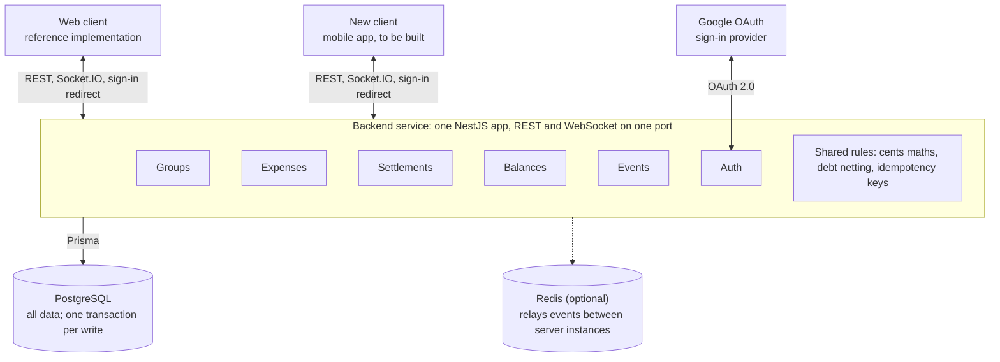

# Split Money — Software Requirements Specification

2026-10-12 · Duc Nguyen

> Markdown copy exported 2026-10-12 from the living document at https://claude.ai/code/artifact/0862298c-1098-4da4-ae79-d8d2761ed640. Edit the document there and re-export; this file is a snapshot.

## 1. Introduction

This SRS specifies what Split Money does today, precisely enough to rebuild any client against the existing backend or to migrate the backend itself. It describes behaviour, data and rules; it does not prescribe a UI toolkit or platform.

### 1.1 Purpose and audience

- Engineers building a new client (the immediate goal is a mobile app) who need the full functional contract.
- Engineers extending or migrating the backend who need every rule the current code enforces.
- Reviewers checking that a new implementation is functionally equivalent.

### 1.2 Scope

Split Money is a shared-expense tracker. People form groups, record expenses paid by one or more members, split each expense among members, and settle the resulting debts. In scope:

- The backend service (`money-split-backend`): REST API, WebSocket events, data model, calculation rules.
- The behaviour of the reference web client (`money-split-app`): screens, flows, validation and state handling, described platform-neutrally.

Out of scope: visual design, deployment runbooks, and any earlier native-client work. Requirements here are derived only from the backend and the web client.

### 1.3 How this document was derived

Every requirement was read from source code on the `master` branch of the backend and `main` of the web client, as of the byline date. Where the code and its comments disagree, the code wins and the disagreement is listed in section 16. Nothing here is aspirational unless marked **Planned** or **Gap**.

### 1.4 Conventions

- Requirements carry stable IDs: `FR-<AREA>-<n>` functional, `BR-<n>` business or calculation rule, `NFR-<n>` non-functional.
- "Shall" marks behaviour the current system enforces. "Client shall" marks behaviour the reference client implements and a new client must reproduce.
- Money amounts are decimal numbers in the major unit of their currency (12.50 means twelve and a half dollars), never integer cents on the wire.
- All identifiers are UUID strings. All timestamps are ISO 8601 in UTC.

### 1.5 Glossary

| Term | Meaning |
| --- | --- |
| User | A person with an account, identified by email. Signs in with Google today. |
| Group | A shared ledger with a name, a default currency and an invite code. |
| Member | A participant in one group. Balances, payers and splits always reference the member, never the user. |
| Guest | A member with no user account, added by name so absent people can be included in splits. |
| Owner | The member role held by the group's creator. Only the owner can delete the group; the owner cannot leave. |
| Expense | One purchase: description, amount, currency, date, category, who paid, and how it is split. |
| Payer | A member who paid part or all of an expense. An expense has one or more payers. |
| Split | One member's share of an expense. |
| Split type | How shares are computed: `EVEN`, `EXACT`, `PERCENTAGE` or `SHARES`. |
| Balance | A member's net position in one group and one currency. Positive means the group owes them; negative means they owe. |
| Debt | A pairwise amount one member owes another in one currency. |
| Settlement | A recorded payment from one member to another that reduces debt. |
| Settlement suggestion | A computed, not-yet-recorded payment that would clear balances with the fewest transfers. |
| Settle all | Recording every outstanding currency between two members in one action. |
| Reference total | A display-only sum of multi-currency amounts in one chosen currency, using rates the user types in. |
| Soft delete | Marking a row deleted with a timestamp instead of removing it. |

## 2. Overall description

Split Money is a client-server product: one backend holds all data and rules, and clients are thin views over its API. Today there is one client, a responsive web app.

### 2.1 Product functions

1. Sign in with a Google account.
2. Create groups, and join groups with an invite code or link.
3. Add guests, people without accounts, to a group.
4. Record expenses with one or several payers, split evenly, by exact amounts, by percentage or by shares, in any of 30 currencies, tagged with a category.
5. See who owes whom, per currency, with a suggested minimal set of payments.
6. Record payments: one at a time, all currencies for a pair at once, or on behalf of a guest.
7. Browse a merged history of expenses and payments.
8. See spending analytics by category and by person.
9. Export a group's expenses to a spreadsheet.
10. See changes made by other members immediately.

### 2.2 User classes

| Class | Who | Can do |
| --- | --- | --- |
| Visitor | Anyone with an invite link, not signed in | Preview a group's name, currency and member count; sign in |
| User | A signed-in person | Create groups, join groups, see their cross-group balance |
| Member | A user inside a specific group | Everything in that group: expenses, settlements, guests, rename, export, leave |
| Owner | The member who created the group | Everything a member can, plus delete the group. Cannot leave. |
| Guest | A named participant with no account | Nothing directly. Other members record expenses and payments for them. |

Roles are per group: the same user can own one group and be an ordinary member of another.

### 2.3 Operating environment

- **Backend**: a Node.js service with a PostgreSQL database, optionally Redis. One instance serves REST and WebSocket traffic on one port.
- **Reference client**: a single-page web app for current desktop and mobile browsers, with a layout that adapts between a side navigation and a bottom navigation.
- **New clients**: any platform that can make HTTPS requests, hold a Socket.IO connection and complete an OAuth browser redirect.

### 2.4 Design constraints

- The backend is the single source of truth for balances. Clients may compute previews but must display server results.
- Currencies are never converted. A group can hold several independent ledgers, one per currency.
- Every financial reference uses the group member, not the user account, so guests and users are interchangeable in calculations.
- Deleting is soft: groups, members and expenses are flagged, not removed.
- There is one API version, unversioned in its paths. A change to it affects every client at once.

### 2.5 Assumptions and dependencies

- Users have a Google account. No other sign-in is offered by a client today.
- Group members trust each other: any member may change any expense (GAP-04).
- Groups are small, tens of members, and histories are in the hundreds to low thousands of items. Nothing is tuned beyond that.
- The product depends on Google OAuth being reachable at sign-in, and on nothing external afterwards.

## 3. System context and architecture

A client talks to the backend in exactly three ways: a browser redirect to sign in, REST calls for all reads and writes, and a Socket.IO connection for change notifications. The backend is a modular NestJS application over one PostgreSQL database.



Both clients use the same REST, Socket.IO and sign-in redirect contract; the exchange-rate module is left out because no client calls it.

### 3.1 Backend modules

| Module | Responsibility | Talks to |
| --- | --- | --- |
| Auth | Google and Apple OAuth, email and password, JWT issue and verification | Users table, Google, Apple |
| Groups | Groups, membership, invites, guests | Events |
| Expenses | Expense create, edit, delete; history; balances; suggestions; analytics; export | Events, shared helpers |
| Settlements | Record payments, settle all, guest settlement, settle-up | Events, shared helpers |
| Balances | Cross-group summary for one user |  |
| Exchange rates | Daily cached rates and their endpoint | External rates API |
| Events | Socket.IO gateway, group rooms, broadcast helpers | Optional Redis |
| Prisma | Database access | PostgreSQL |

Shared helpers hold the rules both Expenses and Settlements rely on: cents conversion, pairwise debt netting and idempotency.

### 3.2 Integration points for a new client

| Concern | What the client needs |
| --- | --- |
| Sign-in | Open `GET /auth/google/mobile?mobile_redirect=<return URL>` in a system browser session, and capture `token` from the URL it returns to. |
| API | The base URL of the backend and the `Authorization: Bearer` header. |
| Real-time | A Socket.IO v4 client pointed at `<base URL>/events` with `auth: {token}`. |
| Files | Ability to save or share a binary download for the export. |
| Deep links | Optional: handle `/join/<code>` links and route them to the invite flow. |

No client-side secrets are required. The Google client secret lives only on the server.

### 3.3 Request lifecycle for a write

1. The client sends the mutation with its bearer token and, where supported, an idempotency key.
2. The server authenticates, validates the body, and checks group membership.
3. Inside one database transaction it writes the record and updates member balances and debts.
4. It returns the result to the caller and broadcasts an event to the group's room.
5. Every connected client in that group, including the caller, refetches the views that event affects.

## 4. Domain model and data dictionary

The system persists 11 entities in PostgreSQL through Prisma. Money is stored as `Decimal(18,6)` and returned to clients as JSON numbers. Source: `money-split-backend/prisma/schema.prisma`.

### 4.1 Relationships

- A **User** has many **GroupMember** rows (one per group joined) and many created **Groups**.
- A **Group** has many **GroupMembers**, **Expenses**, **Settlements**, **MemberBalances** and **Debts**.
- A **GroupMember** belongs to one group and optionally one user. A guest has no user.
- An **Expense** has one or more **ExpensePayers** and one or more **ExpenseSplits**, each pointing at a member.
- A **Settlement** points at a paying member (`from`) and a receiving member (`to`).
- **MemberBalance** is unique per (group, member, currency). **Debt** is unique per (group, debtor, creditor, currency).

Everything financial hangs off the member, not the user. A client must translate "me" into "my member ID in this group" before reading any balance, payer or split.

### 4.2 Enumerations

| Enum | Values | Notes |
| --- | --- | --- |
| `GroupRole` | `OWNER`, `MEMBER` | Creator becomes `OWNER`. There is no ownership transfer. |
| `SplitType` | `EVEN`, `EXACT`, `PERCENTAGE`, `SHARES` | See section 11 for the maths. |
| `ExpenseCategory` | `FOOD`, `TRANSPORT`, `RENT`, `UTILITIES`, `ENTERTAINMENT`, `SHOPPING`, `TRAVEL`, `HEALTH`, `OTHER` | Default `OTHER`. |
| `SettlementStatus` | `PENDING`, `COMPLETED`, `REJECTED` | Only `COMPLETED` is ever written. The other two are unused. |

### 4.3 User (`users`)

| Field | Type | Rules |
| --- | --- | --- |
| `id` | UUID | Primary key. |
| `email` | string | Unique. The key used to link sign-in providers to one account. |
| `passwordHash` | string, nullable | bcrypt, 10 rounds. Null for accounts created through Google or Apple. |
| `googleId` | string, nullable | Unique. Set on first Google sign-in. |
| `appleId` | string, nullable | Unique. Set on first Apple sign-in. |
| `name` | string | From the provider profile or registration form. |
| `avatarUrl` | string, nullable | Google picture URL, or a DiceBear URL seeded by email. |
| `createdAt`, `updatedAt` | timestamp | Managed by the database layer. |
| `deletedAt` | timestamp, nullable | Present but never written or checked. |

### 4.4 Group (`groups`)

| Field | Type | Rules |
| --- | --- | --- |
| `id` | UUID | Generated by the server before insert. |
| `name` | string | Required, non-empty. No length limit enforced. |
| `inviteCode` | string | Unique, 8 characters. First 8 hex characters of SHA-256(group id), upper-cased. Never changes. |
| `currency` | string | Default `USD`. The group's default currency for new expenses and analytics. Not validated against a currency list. |
| `createdBy` | UUID | The creating user. |
| `createdAt`, `updatedAt` | timestamp |  |
| `deletedAt` | timestamp, nullable | Soft delete. Deleted groups are invisible to every read. |

### 4.5 GroupMember (`group_members`)

| Field | Type | Rules |
| --- | --- | --- |
| `id` | UUID | The **member ID** used by every financial record. |
| `groupId` | UUID |  |
| `userId` | UUID, nullable | Null for guests. Unique together with `groupId`, so a user has at most one member row per group. |
| `name` | string | Copied from the user at join time, or typed for a guest (max 50 characters). Not kept in sync with the user afterwards. |
| `avatarUrl` | string, nullable | Copied from the user at join time. Null for guests. |
| `role` | `GroupRole` | Default `MEMBER`. |
| `isGuest` | boolean | Default false. True for members without an account. |
| `joinedAt` | timestamp |  |
| `deletedAt` | timestamp, nullable | Soft delete, set when a member leaves or a guest is removed. Cleared if the same user rejoins. |

### 4.6 Expense (`expenses`)

| Field | Type | Rules |
| --- | --- | --- |
| `id` | UUID |  |
| `groupId` | UUID |  |
| `description` | string | Required, non-empty. |
| `amount` | decimal | Total, at least 0.01. |
| `splitType` | `SplitType` |  |
| `category` | `ExpenseCategory` | Default `OTHER`. |
| `currency` | string | Default `USD` when omitted, not the group currency. |
| `date` | timestamp | When the expense happened. Defaults to the time of the request. |
| `roundingDiff` | decimal | Default 0. Never written. |
| `exchangeRate` | decimal, nullable | Never written. |
| `createdAt`, `updatedAt` | timestamp | `updatedAt` doubles as the optimistic-lock version on edit and delete. |
| `deletedAt` | timestamp, nullable | Soft delete. |

There is no record of which user created or last edited an expense.

### 4.7 ExpensePayer (`expense_payers`) and ExpenseSplit (`expense_splits`)

| Entity | Field | Type | Rules |
| --- | --- | --- | --- |
| ExpensePayer | `expenseId`, `memberId` | UUID | Unique pair: a member appears at most once as payer. |
| ExpensePayer | `amount` | decimal | What this member paid. Payer amounts sum to the expense amount. |
| ExpenseSplit | `expenseId`, `memberId` | UUID | Unique pair: a member appears at most once in the split. |
| ExpenseSplit | `amount` | decimal | This member's computed share. Split amounts sum to the expense amount. |
| ExpenseSplit | `share` | decimal, nullable | The weight entered, kept only for `SHARES`. |
| ExpenseSplit | `percentage` | decimal, nullable | The percentage entered, kept only for `PERCENTAGE`. |

Payer and split rows are deleted and recreated on every edit. Deleting a member row that is still referenced by a payer or split is blocked by the database.

### 4.8 MemberBalance (`member_balances`)

| Field | Type | Rules |
| --- | --- | --- |
| `groupId`, `memberId`, `currency` | UUID, UUID, string | Unique triple. |
| `balance` | decimal | Net position. Positive: the member is owed. Negative: the member owes. |
| `updatedAt` | timestamp |  |

This is the authoritative ledger. Rows are created lazily the first time a member is touched by an expense or settlement in that currency, and are never deleted.

### 4.9 Debt (`debts`)

| Field | Type | Rules |
| --- | --- | --- |
| `groupId`, `debtorId`, `creditorId`, `currency` | UUID, UUID, UUID, string | Unique quadruple. |
| `amount` | decimal | What the debtor owes the creditor. Always positive; a row that reaches zero is deleted. |

A pairwise graph maintained alongside balances. No API response reads it today, and it can drift from net balances. Treat it as internal.

### 4.10 Settlement (`settlements`)

| Field | Type | Rules |
| --- | --- | --- |
| `id` | UUID |  |
| `groupId`, `fromId`, `toId` | UUID | `from` paid `to`. Both are member IDs. |
| `amount` | decimal | At least 0.01. |
| `currency` | string | Default `USD`. |
| `status` | `SettlementStatus` | Always `COMPLETED`. |
| `note` | string, nullable | Free text, or a system label: `Settlement`, `Automatic Settle Up`, `Settle All`, `Received from <guest name>`. |
| `createdAt`, `updatedAt` | timestamp | `createdAt` is the settlement's date in history. |
| `deletedAt` | timestamp, nullable | Present, but no operation deletes a settlement. |

### 4.11 IdempotencyKey (`idempotency_keys`) and ExchangeRate (`exchange_rates`)

| Entity | Field | Rules |
| --- | --- | --- |
| IdempotencyKey | `key` | Primary key. The client-supplied `Idempotency-Key` header value. Global, not scoped per user or endpoint. |
| IdempotencyKey | `userId`, `endpoint` | Recorded for diagnostics only; not part of the lookup. |
| IdempotencyKey | `statusCode` | 0 while the request is in flight, 201 once complete. |
| IdempotencyKey | `responseBody` | The JSON response replayed on a repeat. |
| ExchangeRate | `baseCurrency`, `targetCurrency`, `date` | Unique triple. One row per pair per day. |
| ExchangeRate | `rate` | `Decimal(18,8)`. Units of target per one unit of base. |

Idempotency keys are never expired or cleaned up.

### 4.12 Invariants

- **INV-1** For every group and currency, the sum of all `MemberBalance.balance` values is zero.
- **INV-2** For every expense, payer amounts and split amounts each sum to the expense amount, to the cent.
- **INV-3** A member appears at most once among an expense's payers and at most once among its splits.
- **INV-4** A user has at most one member row per group, active or soft-deleted.
- **INV-5** Exactly one member per group has role `OWNER`, and it is the creator.

## 5. Functional requirements: authentication and accounts

Users sign in with Google and receive a JWT that authenticates every later request. Email and password endpoints and Apple sign-in exist on the server but are not offered by the reference client. Source: `src/auth/*`.

### 5.1 Google sign-in

- **FR-AUTH-01** The system shall start Google OAuth 2.0 when the client opens `GET /auth/google` in a browser context, requesting scopes `email` and `profile`.
- **FR-AUTH-02** On a successful callback the system shall find the user by the Google account's email. If found without a `googleId`, it shall link the Google ID to that user. If not found, it shall create a user with name `"<given> <family>"` and the Google picture as avatar.
- **FR-AUTH-03** The system shall then issue a JWT and redirect the browser to `<FRONTEND_URL>/auth/callback?token=<jwt>`.
- **FR-AUTH-04** For clients that cannot receive that web redirect, the system shall offer `GET /auth/google/mobile?mobile_redirect=<url>`. It redirects to Google with `state` set to base64 of `{"mobileRedirect":"<url>"}`. After sign-in the shared callback redirects to `<url>?token=<jwt>` instead of the web front end.
- **FR-AUTH-05** An existing user's name and avatar shall not be refreshed from Google on later sign-ins.

### 5.2 Token and session

- **FR-AUTH-06** The JWT payload shall contain `sub` (user ID), `email`, `name` and `picture` (avatar URL or null), plus standard `iat` and `exp`.
- **FR-AUTH-07** Token lifetime is set by `JWT_EXPIRES_IN` (the sample configuration uses 7 days). There is no refresh token; an expired token requires a new sign-in.
- **FR-AUTH-08** Every protected request shall carry `Authorization: Bearer <jwt>`. The server verifies signature and expiry, then loads the user by `sub`. A missing, invalid or expired token, or a user that no longer exists, yields 401.
- **FR-AUTH-09** There is no server-side sign-out or token revocation. Signing out is a client action: discard the token.
- **FR-AUTH-10** There is no endpoint that returns the current user. The client reads the profile from the JWT payload.

### 5.3 Client session behaviour

- **FR-AUTH-11** Client shall, on receiving the token, decode the payload without verifying it, require `sub` and `email`, and build the session user `{id, email, name (default "User"), picture}`. If either field is missing it shall show "Invalid token received" and return to sign-in.
- **FR-AUTH-12** Client shall persist the token and user across restarts and treat their presence as signed in.
- **FR-AUTH-13** Client shall treat any 401 from any API call as a forced sign-out: clear all locally stored state and show the sign-in screen.
- **FR-AUTH-14** Client shall open the real-time connection after sign-in using the same token, and close it on sign-out (section 10).
- **FR-AUTH-15** Client shall send unauthenticated users to sign-in, except on the invite page (section 6.3), and shall send authenticated users away from the sign-in screen to the home screen.

### 5.4 Email and password (server only)

- **FR-AUTH-16** `POST /auth/register` shall accept `email` (valid email), `password` (at least 6 characters) and `name` (non-empty). It creates the user with a bcrypt hash and a DiceBear avatar seeded by email, and returns `{user, token}` with status 201. A duplicate email yields 409 "User with this email already exists".
- **FR-AUTH-17** `POST /auth/login` shall accept `email` and `password` and return `{user, token}` with status 200. An unknown email, an account with no password, or a wrong password yields 401 "Invalid credentials".
- The `user` object in both responses is `{id, email, name, avatarUrl}`.

### 5.5 Apple sign-in (server only, not enabled)

- **FR-AUTH-18** `GET /auth/apple` starts Sign in with Apple and `POST /auth/apple/callback` completes it. The server finds the user by `appleId`, then by email (linking the Apple ID), and otherwise creates one. The created name is the Apple-provided name or "Apple User"; the email falls back to `<appleId>@apple.privaterelay.appleid.com`.
- **FR-AUTH-19** The Apple callback redirects only to the web front end. It has no equivalent of `mobile_redirect`.
- The reference client shows Apple sign-in as "Coming soon" and does not call these endpoints. The strategy is inert unless the Apple environment variables are set.

### 5.6 Not supported

Profile editing, changing email, password reset, email verification, account deletion, multi-factor authentication and per-device session management do not exist.

## 6. Functional requirements: groups, membership and guests

A group is created by one user, joined by others with an 8-character invite code, and can include guests who have no account. Every group action below requires the caller to be an active member unless stated. Source: `src/groups/*`.

### 6.1 Create, list, read, update

- **FR-GRP-01** A signed-in user shall be able to create a group with a `name` (required, non-empty) and an optional `currency` (default `USD`). The server generates the ID and the invite code, and adds the creator as a member with role `OWNER`, copying the user's name and avatar.
- **FR-GRP-02** The system shall list the groups where the caller is an active member, excluding deleted groups, newest first. Each item carries the group fields plus `_count.members`.
- **FR-GRP-03** The system shall return one group in full: its fields, active `members`, non-deleted `expenses` (each with `payers` and `splits`, newest `date` first), non-deleted `settlements` (newest first) and `_count.expenses`. A group the caller is not in, or a deleted group, yields 404.
- **FR-GRP-04** Any active member shall be able to change the group's `name` and `currency`. The server broadcasts `group_updated`. Changing the currency does not convert or alter existing expenses or balances.
- Client shall offer the same fixed list of 30 currencies everywhere a currency is chosen (section 13.9).

### 6.2 Join by invite code

- **FR-GRP-05** A signed-in user shall be able to join a group by sending its invite code. The code must be exactly 8 characters and is matched case-insensitively.
- **FR-GRP-06** On success the server creates a member with role `MEMBER`, copies the user's name and avatar, broadcasts `member_joined`, and returns the member (which includes `groupId`).
- **FR-GRP-07** An unknown code or a deleted group yields 404. A user who is already an active member yields 409 "You are already a member of this group".
- **FR-GRP-08** A user who previously left shall be re-activated on the same member row, keeping the same member ID and history. No event is broadcast for a re-activation.
- Client shall trim and upper-case the code before sending, then refresh the group list and open the joined group.

### 6.3 Invite links and preview

- **FR-GRP-09** The system shall expose a public, unauthenticated preview of a group by invite code that returns only `name`, `currency` and `memberCount` (active members). An unknown code yields 404.
- **FR-GRP-10** Client shall support an invite link of the form `/join/<code>` that works whether or not the person is signed in:
  1. Load the preview. On failure show "Invite link invalid".
  2. Show "You're invited to join \<name>" with member count and currency.
  3. If signed in, a "Join group" action joins and opens the group. A join failure is shown inline and the card stays.
  4. If not signed in, a "Sign in to join" action stores the code locally with a timestamp and starts Google sign-in.
  5. After sign-in, if a stored code is younger than 10 minutes, clear it and return to the invite page in auto-join mode, which joins without another tap. A failure here shows a full-page "Couldn't complete your join".
  6. A "Not now" action leaves for the home screen at every step.
- **FR-GRP-11** Client shall let a member copy the invite code to the clipboard from the members screen, confirming with "Copied" for 2 seconds. The reference client copies the bare code, not a link.

### 6.4 Guests

- **FR-GRP-12** Any active member shall be able to add a guest by `name` (required, at most 50 characters). The guest is a member with `isGuest` true, no user, no avatar and role `MEMBER`. The server broadcasts `member_joined`.
- **FR-GRP-13** Any active member shall be able to rename a guest. The server broadcasts `member_joined` again with the updated member; clients must treat that event as an upsert.
- **FR-GRP-14** Any active member shall be able to remove a guest whose balance is exactly zero in every currency. Otherwise the server returns 403 "This guest has an unsettled balance. Settle up before removing them." Removal is a soft delete and broadcasts `member_left`.
- **FR-GRP-15** Only guests can be renamed or removed by others. There is no way to rename or remove a member who has an account.
- **FR-GRP-16** A guest can be a payer, a split participant, and either side of a settlement, exactly like any member.
- Client shall trim the guest name, block empty names, ask for confirmation before removing ("Their past expenses stay in the history"), and mark guests with a visible "Guest" tag wherever members are listed.

### 6.5 Leave and delete

- **FR-GRP-17** A member who is not the owner shall be able to leave a group when their balance is exactly zero in every currency. Otherwise 403 "You must settle all balances before leaving the group". Leaving is a soft delete and broadcasts `member_left`.
- **FR-GRP-18** The owner cannot leave: 403 "Group owner cannot leave. Transfer ownership or delete the group." Ownership transfer does not exist.
- **FR-GRP-19** Only the owner shall be able to delete a group, and only when every active member's balance is exactly zero in every currency. Otherwise 403. Deletion is a soft delete and broadcasts `group_updated` with `deleted: true`.
- Client shall show "Delete group" to the owner and "Leave group" to everyone else, and shall pre-check balances before calling the server, treating any amount under 0.01 as settled. Until balances have loaded the client assumes not settled.
- Client shall return to the home screen after leaving or deleting and drop the group from its list.

### 6.6 Members list

- **FR-GRP-20** Client shall list all active members with avatar (image or initial), name, guest tag where relevant, and each non-zero balance per currency, signed and coloured: positive is owed to them, negative is owed by them.
- **FR-GRP-21** Client shall identify the current user's member by matching `member.userId` to the signed-in user's ID.

## 7. Functional requirements: expenses

Any active member can create, edit or delete any expense in the group. Each change updates member balances and debts atomically and is broadcast to the group. Source: `src/expenses/expenses.service.ts`, `src/expenses/lib/split-calculations.ts`.

### 7.1 Expense content

- **FR-EXP-01** An expense shall have a `description` (required, non-empty), an `amount` of at least 0.01, a `splitType`, at least one payer and at least one split entry.
- **FR-EXP-02** An expense may carry a `currency` (default `USD` when omitted), a `category` (default `OTHER`) and a `date` (default: time of the request). Any currency string is accepted; the expense currency may differ from the group currency.
- **FR-EXP-03** Each payer entry is `{memberId, amount}` with `amount` zero or more. Payer amounts shall sum to the expense amount to the cent, otherwise 400 "Total payers amount (X) must equal expense amount (Y)".
- **FR-EXP-04** Each split entry is `{memberId, amount?, share?, percentage?}`. Which field is read depends on the split type (7.2).
- **FR-EXP-05** Unknown properties in the request body are rejected with 400. Member IDs must be UUIDs. Once the GAP-03 fix ships, each must also be an active member of the group, or already on the expense being edited.

### 7.2 Split types

| Type | Client sends per participant | Server validation | Server stores |
| --- | --- | --- | --- |
| `EVEN` | `memberId` only, for each included member | At least one participant | Equal shares of the total, remainder cents distributed (BR-3) |
| `EXACT` | `memberId`, `amount` | Amounts sum to the total to the cent, else 400 "Exact split amounts must sum to X. Currently Y" | The amounts as sent |
| `PERCENTAGE` | `memberId`, `percentage` | Percentages sum to 100.00 (two-decimal precision), else 400 "Percentages must sum to 100%. Currently N%" | Computed amount plus the percentage |
| `SHARES` | `memberId`, `share` | Total shares greater than 0, else 400 "Total shares must be greater than 0" | Computed amount plus the share weight |

The server always recomputes split amounts; a client-sent `amount` is ignored for every type except `EXACT`.

### 7.3 Create

- **FR-EXP-06** Creating an expense shall, in one database transaction: insert the expense, its payers and its splits; add each payer's amount to that member's balance in the expense currency; subtract each split amount from that member's balance; and update pairwise debts.
- **FR-EXP-07** The create request shall accept an optional `Idempotency-Key` header. A repeat with the same key returns the original response without creating a second expense. A repeat that arrives while the first is still running yields 409 "This request is already being processed".
- **FR-EXP-08** On success the server returns the expense (201) and broadcasts `expense_created` with the same body.
- Client shall generate a fresh random UUID as the idempotency key for each submit attempt.

### 7.4 Edit

- **FR-EXP-09** Editing replaces the whole expense: the request body has the same shape and the same required fields as create. There is no partial update.
- **FR-EXP-10** The server shall reverse the old expense's effect on balances and debts, replace payers and splits, apply the new effect, and broadcast `expense_updated`, all in one transaction.
- **FR-EXP-11** `category` is the only field preserved when omitted. An omitted `currency` resets to `USD` and an omitted `date` resets to the time of the request.
- **FR-EXP-12** The edit is guarded by an optimistic lock on the expense's `updatedAt`. If another edit landed in between, the request fails (see section 16) and the client should reload and retry.
- **FR-EXP-13** An expense that does not exist, is deleted, or belongs to another group yields 404 "Expense not found".

### 7.5 Delete

- **FR-EXP-14** Deleting shall reverse the expense's effect on balances and debts and soft-delete it, in one transaction, then broadcast `expense_deleted` with `{expenseId}`. The response has no body.
- **FR-EXP-15** Client shall implement delete with an undo window: on tapping delete, hide the expense immediately, show an "undo" notice for 8 seconds, and call the server only when the window expires. Undo within the window cancels the delete with no server call.

### 7.6 Categories

- **FR-EXP-16** The nine categories are `FOOD`, `TRANSPORT`, `RENT`, `UTILITIES`, `ENTERTAINMENT`, `SHOPPING`, `TRAVEL`, `HEALTH`, `OTHER`. Each has a display label and icon on the client (section 13.9).
- **FR-EXP-17** Category is optional in the form and defaults to `OTHER`.

### 7.7 Expense entry flow (client)

The reference client enters and edits expenses through a four-step form. State is kept across steps so going back never loses input.

1. **What was it?** Amount (with thousands separators as you type, at most 2 decimals), description, currency (defaults to the group currency), category. Proceed requires a non-blank description and an amount above zero. A hint names what is missing.
2. **Who paid?** Single payer by default, preselecting the first member in the list. A toggle switches to multiple payers, where each selected member gets an amount field and a running "Remaining", "Over" or "Balanced" indicator. Adding a payer pre-fills the remaining amount. Proceed requires the payer amounts to match the total within 0.01.
3. **How to split?** A selector for the four split types, then the matching editor:
   - Split equally: a checkbox per member, all checked by default, with "Each of N selected pays X". At least one must be checked.
   - Exact amounts: an amount per member with a running "sum / total". Must match to the cent.
   - Percentages: a percentage per member with a running "N% / 100.00%". Must equal 100.00.
   - Shares: a whole number per member, with a running total. Total must exceed 0; non-integers are rejected with "Shares must be whole numbers (0 or more)."
4. **Review.** One sentence summarising the expense, for example "Ana paid $90.00, split evenly between 3 people ($30.00 each)." Submit is labelled "Add expense" or "Save changes".

Rules that apply across the flow:

- **FR-EXP-18** Members with a zero or empty value are omitted from the split for `EXACT`, `PERCENTAGE` and `SHARES`.
- **FR-EXP-19** With a single payer, the payer amount always equals the total.
- **FR-EXP-20** New members who appear while the form is open are included in an even split by default; members who disappear are dropped.
- **FR-EXP-21** When adding from outside a group, the client first asks which group, with a search box over group names.
- **FR-EXP-22** Submit is disabled while a request is in flight. Server error text is shown on the review step.
- **FR-EXP-23** The reference client always sends the current time as `date`. It has no date picker, so editing an expense moves it to "now" in history. See section 16.

## 8. Functional requirements: balances and settlement

Balances are kept per member and per currency, never converted between currencies. A settlement is a recorded payment that moves two balances toward zero. Source: `src/expenses/expenses-balances.service.ts`, `src/settlements/*`.

### 8.1 Reading balances

- **FR-BAL-01** The system shall return group balances as a map from currency to a list of `{memberId, name, avatarUrl, balance}`. For every currency that has any balance row, every active member appears, with 0 when they have no row. Members who left are omitted. A currency never used in the group does not appear.
- **FR-BAL-02** The system shall return the caller's own balance as a map from currency to `{totalOwed, totalOwe, details}`. A positive net gives `totalOwed`; a negative net gives `totalOwe` as a positive number; the other is 0. Fully settled currencies are still listed with 0 and 0. `details` is always an empty list.
- **FR-BAL-03** The system shall return a cross-group summary for the caller: per currency, `totalBalance` (net across all groups), `totalOwed` (sum of positive group balances) and `totalOwing` (sum of negative ones, as a positive number), each rounded to 2 decimals. Deleted groups and groups the caller has left are excluded.
- **FR-BAL-04** Client shall treat any amount whose absolute value is below 0.01 as settled and hide it.

### 8.2 Settlement suggestions

- **FR-SET-01** The system shall compute, per currency, the smallest practical set of transfers that brings every balance to zero, using the greedy algorithm in BR-12. `GET /groups/:groupId/settlements` returns them as `{from, to, amount, currency}` where `from` and `to` are `{memberId, name, avatarUrl}`.
- **FR-SET-02** Suggestions are computed on demand and never stored. They change whenever a balance changes.
- **FR-SET-03** Client shall compute the same plan locally from the group balances response, using the identical algorithm, and group the suggestions by (payer, receiver) pair so one pair with several currencies shows as one card.
- **FR-SET-04** When nobody owes anything, client shall show "Everyone is settled up".

### 8.3 Record a payment (single settlement)

- **FR-SET-05** A member shall be able to record that member A paid member B an `amount` (at least 0.01) in a `currency` (default `USD`), with an optional `note`.
- **FR-SET-06** The caller must be an active member, and both `fromId` and `toId` must be active members of the same group, else 403 "Payer is not a member of this group" or "Receiver is not a member of this group". `fromId` equal to `toId` yields 400 "Cannot settle with yourself".
- **FR-SET-07** Recording shall, in one transaction: insert a settlement with status `COMPLETED`; add the amount to the payer's balance; subtract it from the receiver's balance; and reduce the pairwise debt. The server then broadcasts `settlement_updated`.
- **FR-SET-08** The amount is not checked against what is owed. Paying more than owed is accepted and flips the direction of the balance. The caller does not have to be either party.
- **FR-SET-09** The request accepts an optional `Idempotency-Key` header with the same semantics as FR-EXP-07.
- **FR-SET-10** Client shall show "Record payment" on a suggestion only to the member who owes (the `from` side). The dialog pre-fills the suggested amount, lets the user change it, and takes an optional note. Amounts that are not a number or are not above zero are ignored.
- **FR-SET-11** Settlements cannot be edited, deleted or undone through the API.

### 8.4 Settle all (one pair, several currencies)

- **FR-SET-12** When one pair has suggestions in two or more currencies, a member shall be able to record all of them in one request: `{fromId, toId, items: [{currency, amount}]}` with at least one item.
- **FR-SET-13** The `Idempotency-Key` header is mandatory here; without it the server returns 400 "Idempotency-Key header is required for this endpoint".
- **FR-SET-14** The server shall validate the whole batch before changing anything:
  1. Both members are active in the group (403 otherwise).
  2. No currency appears twice (400 "Duplicate currency in settle-all request").
  3. For each item, recompute the current suggestions for that currency and find the one from `fromId` to `toId`. If none exists: 400 "No current \<CUR> balance to settle between these members. Your balances changed - refresh and try again."
  4. If the current amount differs from the submitted amount by more than 0.005: 400 "The \<CUR> amount changed. Your balances changed - refresh and try again."
- **FR-SET-15** Only if every item passes shall the server record one settlement per currency, using the server's own computed amount, with note "Settle All". It returns `{settlements: [...]}` and broadcasts `settlement_updated` once per settlement.
- **FR-SET-16** Client shall show the action as "Settle all" on a pair card with two or more currencies, list each currency amount, state "This records N separate payments", and on a 400 show the server message and let the user refresh.

### 8.5 Reference total with manual rates (client only)

- **FR-SET-17** In the settle-all dialog the client shall show a "for reference only" total in a display currency the user picks from the supported list (default `USD`).
- **FR-SET-18** For every currency in the batch other than the display currency, the client shall show an input "1 \<CUR> = \_\_\_ \<display currency>". The total is the sum of each amount multiplied by its rate. A currency without a rate is left out and the label reads "(some currencies not converted)".
- **FR-SET-19** Changing the display currency clears all entered rates. Rates are never sent to the server or stored, and never change what is settled.

### 8.6 Guest settlement

- **FR-SET-20** Because a guest cannot act, the member who is owed shall be able to mark a guest's debt as received: `{guestMemberId, currency, amount}` with amount at least 0.01.
- **FR-SET-21** The server shall require that the target is an active guest in the group (400 "Guest member not found or not a guest in this group") and that the guest's balance in that currency is negative (400 "Guest has no outstanding debt in this currency").
- **FR-SET-22** The recorded amount shall be the smaller of the submitted amount and the guest's total debt in that currency. The settlement is from the guest to the caller, with note "Received from \<guest name>". The response is `{settlements: [one]}`.
- **FR-SET-23** Client shall show "Mark as received" (and "Mark all received" for several currencies) on a suggestion where the payer is a guest and the current user is the receiver. For several currencies the client sends one guest-settlement request per currency, each with its own idempotency key.

### 8.7 Settle up the whole group (server only)

- **FR-SET-24** `POST /groups/:groupId/settle-up` shall compute the transfers for every currency, or for one `currency` if given, and record all of them as settlements with note "Automatic Settle Up", bringing every balance to zero. It returns `{settlements: [...]}`, or an empty list if nothing is owed.
- The reference client does not call this endpoint. It is a group-wide action any member can trigger, so a new client should gate it behind an explicit confirmation if it exposes it at all.

### 8.8 Refresh after a settlement

- **FR-SET-25** After any settlement succeeds, client shall reload the group, history, own balance, group balances and the cross-group summary. Other clients in the group receive `settlement_updated` and reload balances and history.

## 9. Functional requirements: history, analytics, export and rates

A group has one merged, paginated history of expenses and settlements, four analytics views over expenses, and a spreadsheet export. All require active membership. Source: `src/expenses/expenses.service.ts`, `expenses-analytics.service.ts`, `expenses-export.service.ts`, `src/balances/*`, `src/exchange-rates/*`.

### 9.1 Transaction history

- **FR-HIS-01** The system shall return expenses and settlements merged into one list, newest first. Expenses sort by their `date`; settlements by their creation time. Ties break by ascending ID.
- **FR-HIS-02** The list is cursor-paginated. `limit` defaults to 20 and is capped at 50. The response is `{items, nextCursor, hasMore}`. The cursor is opaque to the client (base64 of the last item's date and ID); a malformed cursor is treated as the first page.
- **FR-HIS-03** An expense item is `{id, type: "EXPENSE", description, amount, currency, category, date, payers[], receivers[]}`. `payers` are who paid; `receivers` are the split participants. Each entry is `{memberId, amount, name, avatarUrl}`.
- **FR-HIS-04** A settlement item is `{id, type: "SETTLEMENT", description, amount, currency, date, status, from, to}`. `description` is the note, or "\<from> paid \<to>" when there is none. `from` and `to` are `{memberId, name, avatarUrl}`.
- **FR-HIS-05** Names in history come from the member row at read time, so members who have since left still appear by name.
- **FR-HIS-06** History items do not carry `splitType` or per-split `share` and `percentage`. To edit an expense the client reads the full expense from the group detail response (FR-GRP-03).

Client behaviour:

- **FR-HIS-07** Client shall group history by calendar month ("October 2026") and load the next page automatically as the user nears the end, with a "Failed to load, retry" control on error.
- **FR-HIS-08** Each row shows an icon (receipt for an expense, arrow for a settlement), the description, the category icon for expenses, a sentence "\<payers> paid for \<receivers>" or "\<from> paid \<to>", the amount in its own currency, and the day and short month.
- **FR-HIS-09** In the sentence, more than two payers collapse to "A, B and N more"; receivers exclude the payers themselves and read "themselves" when nobody else is involved.
- **FR-HIS-10** Expense rows offer edit and delete. Expenses in the delete-undo window are hidden from the list.
- **FR-HIS-11** When a real-time event arrives while a next page is loading, the client shall defer the first-page reload until that load finishes, so the list is not corrupted.
- **FR-HIS-12** An empty history shows "No expenses yet" with an add-expense action.

### 9.2 Analytics

All four endpoints share these query parameters: `currency` (defaults to the group currency), `from` and `to` (optional ISO dates, inclusive bounds on expense `date`). They consider only non-deleted expenses in exactly that one currency. Settlements are never included. Amounts are returned as integer `totalCents` (amount times 100).

| Requirement | Endpoint suffix | Returns | Notes |
| --- | --- | --- | --- |
| **FR-ANA-01** Spending by category | `expenses/by-category` | `[{category, totalCents}]` | Sum of expense amounts per category. Categories with no spending are absent. |
| **FR-ANA-02** Spending by person | `expenses/by-person?metric=paid\|share` | `[{memberId, name, totalCents}]` | `paid` (default) sums what each member paid; `share` sums each member's split amounts. Members who left are excluded. |
| **FR-ANA-03** Category per person | `expenses/by-person-category` | `[{memberId, name, category, totalCents}]` | Split amounts grouped by member and category. Members who left are excluded. |
| **FR-ANA-04** Top expenses | `expenses/top?limit=N` | `[{id, description, amount, currency, category, date, payerNames[]}]` | Largest first. `limit` defaults to 5, clamped to 1 to 20. `amount` here is a decimal, not cents. |

Client behaviour:

- **FR-ANA-05** Client shall show an Analytics view per group with four cards: a donut of spending by category with a legend of amount and percentage; a donut of spending by person with a Paid or Share toggle; a stacked bar per person broken down by category; and a ranked list of the top 5 expenses.
- **FR-ANA-06** Donuts show at most 5 slices plus one "Other" slice that sums the rest. Six items are shown as six slices without folding.
- **FR-ANA-07** Category colours are fixed per category. Member colours are derived deterministically from the member ID so they stay stable across sessions.
- **FR-ANA-08** Tapping a top expense opens it for editing.
- **FR-ANA-09** Each card has its own loading, error ("Couldn't load ...") and empty ("No expenses yet") state. Analytics always uses the group's currency; the reference client offers no currency or date filter.
- **FR-ANA-10** Client shall refetch the category card on every expense event; the other cards refresh when the view is opened.

### 9.3 Spreadsheet export

- **FR-EXP-X1** The system shall export a group's complete expense history as one `.xlsx` file with a single sheet named "Expenses", containing three blocks in order:
  1. **Balances**: columns Member, Currency, Net balance. Currencies where everyone is at zero are omitted; otherwise every active member is listed.
  2. **Settlement plan**: columns From, To, Amount, Currency, or the single line "Everyone is settled up".
  3. **Expense list**: columns Date (YYYY-MM-DD), Description, Amount, Currency, Category, Payer(s) (comma-separated names), Split type, then one column per member who ever appeared in any expense, sorted by name, holding that member's split amount or blank if they did not take part. Oldest expense first.
- **FR-EXP-X2** The response is a binary download with a `Content-Disposition` filename of `<group name>-expenses.xlsx`, sanitised of characters invalid in filenames, with a UTF-8 variant for non-ASCII names. An empty name falls back to `group`.
- **FR-EXP-X3** Settlements themselves are not listed in the export; only the current plan is.
- **FR-EXP-X4** Client shall offer an Export action on the group screen, show "Exporting..." while it runs, save or share the file under the name above, and show the error message on failure.

### 9.4 Cross-group summary

- **FR-SUM-01** The home screen shall show the caller's position across all groups from `GET /balances/summary` (FR-BAL-03): a line "You're owed ..." listing positive currencies and a line "You owe ..." listing negative ones, largest first, or "All settled".
- **FR-SUM-02** Each line shows at most 3 currencies with a "+N more" expander.

### 9.5 Exchange rates (server only)

- **FR-FX-01** `GET /exchange-rates?base=<CUR>` shall return `{base, date, rates, stale}` from a server-side cache: the most recent day's rates for that base, `stale` true when older than 48 hours, and `{date: null, rates: {}, stale: true}` when none are cached. `base` defaults to `USD`.
- **FR-FX-02** A scheduled job at 01:00 daily fetches USD-based rates from `open.er-api.com` and stores them. Only USD is ever cached, so other bases return empty.
- **FR-FX-03** Nothing in the product uses these rates today. The reference client replaced them with manually typed rates (FR-SET-17 to 19) because the upstream source was unreliable. No amount is ever converted server-side.

## 10. Functional requirements: real-time events

The server pushes group changes over Socket.IO so every member's screen stays current without polling. Events are hints to refetch, not a replacement for the REST API. Source: `src/events/events.gateway.ts`, client `src/hooks/useGroupEvents.ts`.

### 10.1 Connection

- **FR-RT-01** The server exposes a Socket.IO (v4) namespace at `/events` on the same host as the REST API.
- **FR-RT-02** The client shall connect with the JWT in the handshake `auth` object: `{token: "<jwt>"}`. The server verifies it on connect and disconnects the socket if it is missing, invalid or expired. No error payload is sent.
- **FR-RT-03** Client shall keep one connection per signed-in session, prefer the WebSocket transport with long-polling as fallback, retry up to 10 times at 1 second intervals, and open a new connection if the token changes.

### 10.2 Rooms

- **FR-RT-04** To receive a group's events the client shall emit `join_group` with `{groupId}`. The server checks the user is an active member and replies through the acknowledgement: `{event: "joined", data: groupId}` on success, or `{error: "unauthorized" | "bad_request" | "forbidden" | "internal"}`.
- **FR-RT-05** The client shall emit `leave_group` with `{groupId}` when it stops showing that group. The payload must be an object; a bare string is rejected.
- **FR-RT-06** Room membership is lost on disconnect. Client shall re-emit `join_group` after every reconnect.
- **FR-RT-07** A socket may be in several group rooms. The reference client joins only the group currently on screen.

### 10.3 Server-to-client events

| Event | Payload | Emitted when | Reference client reaction |
| --- | --- | --- | --- |
| `expense_created` | The expense response (section 12.5), including `groupId` | An expense is created | Insert into the cached group if absent; reload history page 1, group balances, own balance, category analytics |
| `expense_updated` | The expense response | An expense is edited | Replace in the cached group; same reloads |
| `expense_deleted` | `{expenseId}` | An expense is deleted | Same reloads |
| `settlement_updated` | The settlement response (section 12.6) | Any settlement is recorded; once per settlement in a batch | Reload group balances, own balance, history page 1 |
| `member_joined` | The full member row | A user joins, a guest is added, or a guest is renamed | Add the member if not already present |
| `member_left` | `{memberId, groupId}` | A member leaves or a guest is removed | Remove the member |
| `group_updated` | The group row; plus `deleted: true` on deletion | Name or currency changes, or the group is deleted | Merge into the cached group and group list |

### 10.4 Delivery semantics

- **FR-RT-08** Events go to every socket in the group room, including the one whose request caused the change. Clients must handle their own echoes idempotently.
- **FR-RT-09** Delivery is best effort with no replay. A client that was offline shall refetch state when it returns to a group screen rather than rely on missed events.
- **FR-RT-10** Events are emitted from inside the database transaction in some paths, so a client may receive an event slightly before the change is readable. Refetches triggered by events must tolerate that; see section 16.
- **FR-RT-11** With `REDIS_URL` set, the server uses the Socket.IO Redis adapter so events reach clients connected to any server instance.
- **FR-RT-12** There are no push notifications, email notifications or in-app notification history. A client that is not connected learns of changes only when it next loads data.

## 11. Calculation rules

All money maths runs in integer hundredths ("cents") and is converted back to decimals for storage and transport. A reimplementation must reproduce these rules exactly or balances will drift from the server's. Source: `src/helpers/number.helper.ts`, `src/expenses/lib/split-calculations.ts`, `src/helpers/debt.helper.ts`, `src/settlements/settlement.algo.ts`, client `src/lib/accounting.ts`.

### 11.1 Precision and sign

- **BR-1 Cents.** `cents = round(amount * 100)` and `amount = cents / 100`. This applies to every currency, including ones with no minor unit such as JPY and VND; they are still handled with two decimals.
- **BR-2 Sign.** A positive balance means the member is owed money. A negative balance means the member owes. Within one group and currency, all balances sum to zero.

### 11.2 Splitting an amount (largest remainder)

**BR-3** Given a total in cents and a weight per participant:

1. For each participant compute `exact = totalCents * weight / totalWeight`, take `base = floor(exact)` and `frac = exact - base`.
2. Let `remainder = totalCents - sum(base)`.
3. Give one extra cent to each of the `remainder` participants with the largest `frac`. Ties keep the order the participants were sent in.

Weights by split type: `EVEN` uses 1 for every participant; `PERCENTAGE` uses the percentages; `SHARES` uses the share numbers. `EXACT` skips this and uses the amounts as given. A total weight of 0 is rejected.

| Example | Input | Result |
| --- | --- | --- |
| Even, 3 people | 100.00 | 33.34, 33.33, 33.33 (first listed gets the extra cent) |
| Even, 3 people | 0.02 | 0.01, 0.01, 0.00 |
| Percentage | 10.00 at 33.33, 33.33, 33.34 | 3.33, 3.33, 3.34 |
| Shares | 50.00 at 1, 2, 2 | 10.00, 20.00, 20.00 |

The client's own "each pays" preview is `total / n` to 2 decimals and may differ from the stored shares by a cent. The server's result is authoritative.

### 11.3 Validation tolerances

- **BR-4** Payer amounts must equal the total exactly in cents (server). The client allows the form to proceed within 0.01 and the server then decides.
- **BR-5** Exact split amounts must equal the total exactly in cents.
- **BR-6** Percentages must satisfy `round(sum * 100) == 10000`, that is 100.00 to two decimals.
- **BR-7** Shares: the server accepts any non-negative numbers with a positive total. The client restricts input to whole numbers.

### 11.4 Effect of an expense on balances

**BR-8** For an expense in currency C:

- each payer's balance in C increases by the amount they paid;
- each participant's balance in C decreases by their split amount.

A member who both paid and took part nets the two. Balance rows are created on first use.

Worked example. Ana pays 90.00, split evenly among Ana, Ben and Cai:

| Member | Paid | Share | Balance change |
| --- | --- | --- | --- |
| Ana | 90.00 | 30.00 | +60.00 |
| Ben | 0 | 30.00 | -30.00 |
| Cai | 0 | 30.00 | -30.00 |

**BR-9** Editing an expense first applies the exact inverse of the stored expense (payers decrease, participants increase), then applies the new version. Deleting applies only the inverse.

### 11.5 Pairwise debts

**BR-10** Debts are derived per expense by overlaying two rulers of length `totalCents`: payers laid end to end in the order sent, and participants laid end to end in the order sent. Wherever a participant's segment overlaps a payer's segment, that participant owes that payer the overlap, unless they are the same member.

**BR-11** Recording that D owes C an amount first cancels against any existing debt of C to D in that currency. Only the excess is stored, and a debt that reaches zero is deleted. So at most one direction exists per pair and currency.

Debts are bookkeeping only. Balances, suggestions and every API response are derived from member balances, not from debts.

### 11.6 Settlement suggestions (greedy matching)

**BR-12** Per currency:

1. Convert each balance to cents. Ignore zeros.
2. Sort debtors (negative) from most negative; sort creditors (positive) from most positive.
3. Take the first debtor and first creditor. Transfer `min(|debtor|, creditor)` from debtor to creditor.
4. Reduce both. Advance past whichever reached zero. Repeat until either list is exhausted.

This yields at most (members - 1) transfers per currency. It is not guaranteed to be the mathematical minimum in every case, but server and client both use it, so they agree.

Continuing the example: debtors Ben -30.00 and Cai -30.00; creditor Ana +60.00. Result: Ben pays Ana 30.00, Cai pays Ana 30.00.

**BR-13** When two members have equal balances, their relative order follows the order of the input list. The server and a client may hold that list in different orders, so the pairing can differ between them for tied amounts. This matters for settle all, which revalidates against the server's pairing (FR-SET-14).

**BR-14** The server variant used by settle-up and settle-all throws if the balances for a currency do not sum to zero. That surfaces as a 500 and indicates corrupted data.

### 11.7 Effect of a settlement

**BR-15** A settlement of amount X from P to R in currency C increases P's balance by X and decreases R's by X. In the debt graph it is recorded as R owing P an extra X, netted per BR-11.

### 11.8 Settled thresholds

| Check | Where | Rule |
| --- | --- | --- |
| Leave group, remove guest, delete group | Server | Balance must be exactly 0 |
| Suggestions | Server and client | Balance in cents is not 0 |
| Hide a balance, pre-check leave or delete, payer total | Client | Absolute value below 0.01 |
| Settle-all amount match | Server | Difference no more than 0.005 |

### 11.9 Idempotency

- **BR-16** Endpoints that accept `Idempotency-Key`: create expense, create settlement, settle-up, settle-guest (optional on all four) and settle-all (required). Edit and delete do not.
- **BR-17** The key is claimed inside the same transaction as the mutation. If the mutation fails, the claim rolls back and the same key may be retried. On success the response body is stored and replayed for any later request with that key.
- **BR-18** A second request with the same key while the first is running gets 409.
- **BR-19** Keys are global strings with no expiry. Clients shall use a fresh random UUID per user action and reuse it only when retrying that same action.

### 11.10 Concurrency

- **BR-20** Every mutation that touches balances runs in a single database transaction.
- **BR-21** Expense edit and delete use `updatedAt` as an optimistic lock, so two simultaneous edits cannot both apply.
- **BR-22** The balance checks for leaving, deleting a group and removing a guest run in the same transaction as the write, so a concurrent expense cannot slip between check and write.

### 11.11 Display formatting (client)

- **BR-23** Amounts are shown with exactly 2 decimals and comma thousands separators.
- **BR-24** The symbol is a prefix, except VND and THB where it is a suffix. Currencies whose symbol is shared (JPY and CNY share one; SEK, NOK and DKK share one) are prefixed with their code as well, for example `JPY ¥1,200.00`. An unknown currency falls back to `$`.
- **BR-25** Amount inputs strip everything but digits and one decimal point, cap at 2 decimals, and re-insert thousands separators while typing.

## 12. API reference

The backend exposes 38 HTTP routes and one Socket.IO namespace. Unless marked Public, every route requires `Authorization: Bearer <jwt>`. A live OpenAPI description is served at `/docs`.

### 12.1 Conventions

- **Base URL**: one origin for REST and WebSocket. Locally `http://localhost:3000`.
- **Bodies**: JSON, `Content-Type: application/json`. The export is the only non-JSON response.
- **Validation**: bodies are validated and transformed. Unknown properties are rejected, not ignored. A validation failure is 400 with `message` as an array of strings, one per broken rule.
- **Errors**: `{"statusCode": 403, "message": "...", "error": "Forbidden"}`. `message` is a string for business errors and an array for validation errors. Clients should display either.
- **Success codes**: `POST` returns 201 (except login, 200). `GET`, `PATCH` and `DELETE` return 200. Deletes with nothing to return send an empty body.
- **Numbers**: money is a JSON number in most responses. The group detail response is the exception; see 12.4.
- **Membership failures**: group-scoped routes return 403 when the caller is not an active member, with one of two messages depending on the module: "You are not a member of this group" or "You do not have access to this group". Reading one group returns 404 instead.

### 12.2 System

| Method | Path | Auth | Response |
| --- | --- | --- | --- |
| GET | `/` | Public | `Hello World!` (text) |
| GET | `/health` | Public | `{status: "ok", timestamp}` |
| GET | `/docs` | Public | Swagger UI |

### 12.3 Authentication

| Method | Path | Auth | Request | Success | Errors |
| --- | --- | --- | --- | --- | --- |
| POST | `/auth/register` | Public | `{email, password, name}` | 201 `{user, token}` | 400 validation; 409 email exists |
| POST | `/auth/login` | Public | `{email, password}` | 200 `{user, token}` | 401 Invalid credentials |
| GET | `/auth/google` | Public | Browser navigation | 302 to Google |  |
| GET | `/auth/google/mobile` | Public | Query `mobile_redirect=<url>` | 302 to Google with `state` |  |
| GET | `/auth/google/callback` | Public | Called by Google | 302 to `<mobile_redirect>?token=` or `<FRONTEND_URL>/auth/callback?token=` |  |
| GET | `/auth/apple` | Public | Browser navigation | 302 to Apple |  |
| POST | `/auth/apple/callback` | Public | Called by Apple | 302 to `<FRONTEND_URL>/auth/callback?token=` |  |

```json
{
  "user": { "id": "uuid", "email": "a@b.c", "name": "Ana", "avatarUrl": "https://..." },
  "token": "<jwt>"
}
```

JWT payload: `{sub, email, name, picture, iat, exp}`.

### 12.4 Groups

| Method | Path | Request | Success | Errors |
| --- | --- | --- | --- | --- |
| POST | `/groups` | `{name, currency?}` | 201 Group | 400 |
| GET | `/groups` |  | 200 `[Group + _count.members]` |  |
| POST | `/groups/join` | `{inviteCode}` (exactly 8 chars) | 201 Member | 400; 404 code not found; 409 already a member |
| GET | `/groups/preview/:inviteCode` | Public | 200 `{name, currency, memberCount}` | 404 |
| GET | `/groups/:id` |  | 200 GroupDetail | 404 not found or not a member |
| PATCH | `/groups/:id` | `{name?, currency?}` | 200 Group | 403 |
| DELETE | `/groups/:id` |  | 200 Group (with `deletedAt`) | 403 not owner; 403 unsettled balances |
| DELETE | `/groups/:id/leave` |  | 200 empty | 404 not a member; 403 owner; 403 unsettled |
| POST | `/groups/:id/guests` | `{name}` (1 to 50 chars) | 201 Member | 400; 403 |
| PATCH | `/groups/:id/guests/:guestId` | `{name}` | 200 Member | 403; 404 guest not found |
| DELETE | `/groups/:id/guests/:guestId` |  | 200 empty | 403 not a member; 403 unsettled; 404 |

```json
// Group
{ "id": "uuid", "name": "Trip", "inviteCode": "A1B2C3D4", "currency": "USD",
  "createdBy": "user-uuid", "createdAt": "ISO", "updatedAt": "ISO", "deletedAt": null }

// Member
{ "id": "member-uuid", "groupId": "uuid", "userId": "user-uuid or null", "name": "Ana",
  "avatarUrl": "https://... or null", "role": "OWNER | MEMBER", "isGuest": false,
  "joinedAt": "ISO", "deletedAt": null }

// GroupDetail = Group plus:
{ "members": [Member],
  "expenses": [ { "id", "groupId", "description", "amount", "roundingDiff", "splitType",
                  "category", "currency", "exchangeRate", "date", "createdAt", "updatedAt", "deletedAt",
                  "payers": [ { "id", "expenseId", "memberId", "amount" } ],
                  "splits": [ { "id", "expenseId", "memberId", "amount", "share", "percentage" } ] } ],
  "settlements": [ { "id", "groupId", "fromId", "toId", "amount", "currency", "status", "note",
                     "createdAt", "updatedAt", "deletedAt" } ],
  "_count": { "expenses": 12 } }
```

In GroupDetail the raw database rows are returned, so decimal fields (`amount`, `share`, `percentage`, `roundingDiff`, `exchangeRate`) are serialised as JSON **strings** such as `"33.34"`. A client must parse numbers from either a string or a number here. The response is unpaginated and grows with the group's history.

### 12.5 Expenses and history

All paths are under `/groups/:groupId`.

| Method | Path | Request | Success | Errors |
| --- | --- | --- | --- | --- |
| POST | `/expenses` | ExpenseInput; header `Idempotency-Key?` | 201 Expense | 400 validation or sums; 403; 409 key in flight |
| PATCH | `/expenses/:expenseId` | ExpenseInput (full) | 200 Expense | 400; 403; 404 |
| DELETE | `/expenses/:expenseId` |  | 200 empty | 403; 404 |
| GET | `/transactions` | Query `limit?` (default 20, max 50), `cursor?` | 200 `{items, nextCursor, hasMore}` | 403 |
| GET | `/balances` |  | 200 `{ "<CUR>": [{memberId, name, avatarUrl, balance}] }` | 403 |
| GET | `/balances/me` |  | 200 `{ balances: { "<CUR>": {totalOwed, totalOwe, details: []} } }` | 403 |
| GET | `/settlements` |  | 200 `[{from, to, amount, currency}]` | 403 |
| GET | `/expenses/by-category` | Query `currency?`, `from?`, `to?` | 200 `[{category, totalCents}]` | 403 |
| GET | `/expenses/by-person` | Plus `metric?` = `paid` or `share` | 200 `[{memberId, name, totalCents}]` | 403 |
| GET | `/expenses/by-person-category` | Query as by-category | 200 `[{memberId, name, category, totalCents}]` | 403 |
| GET | `/expenses/top` | Plus `limit?` (default 5, 1 to 20) | 200 `[{id, description, amount, currency, category, date, payerNames}]` | 403 |
| GET | `/expenses/export` |  | 200 binary `.xlsx` | 403 |

```json
// ExpenseInput
{ "description": "Dinner",              // required, non-empty
  "amount": 90.00,                       // required, >= 0.01
  "splitType": "EVEN",                   // EVEN | EXACT | PERCENTAGE | SHARES
  "currency": "USD",                     // optional, default USD
  "category": "FOOD",                    // optional, default OTHER
  "date": "2026-10-12T18:30:00.000Z",    // optional, default now
  "payers": [ { "memberId": "uuid", "amount": 90.00 } ],          // >= 1
  "splits": [ { "memberId": "uuid", "amount": 30.00,              // >= 1; amount for EXACT
                "share": 1, "percentage": 33.33 } ] }              // share for SHARES, percentage for PERCENTAGE

// Expense (response and expense_created / expense_updated payload)
{ "id": "uuid", "groupId": "uuid", "description": "Dinner", "amount": 90,
  "splitType": "EVEN", "category": "FOOD", "currency": "USD", "date": "ISO",
  "payers": [ { "memberId": "uuid", "amount": 90, "name": "Ana" } ],
  "splits": [ { "memberId": "uuid", "amount": 30, "share": null, "percentage": null } ] }

// History items
{ "id": "uuid", "type": "EXPENSE", "description": "Dinner", "amount": 90, "currency": "USD",
  "category": "FOOD", "date": "ISO",
  "payers":    [ { "memberId": "uuid", "amount": 90, "name": "Ana", "avatarUrl": null } ],
  "receivers": [ { "memberId": "uuid", "amount": 30, "name": "Ben", "avatarUrl": null } ] }
{ "id": "uuid", "type": "SETTLEMENT", "description": "Ben paid Ana", "amount": 30, "currency": "USD",
  "date": "ISO", "status": "COMPLETED",
  "from": { "memberId": "uuid", "name": "Ben", "avatarUrl": null },
  "to":   { "memberId": "uuid", "name": "Ana", "avatarUrl": null } }
```

Export response headers: `Content-Type: application/vnd.openxmlformats-officedocument.spreadsheetml.sheet` and `Content-Disposition: attachment; filename="<ascii>-expenses.xlsx"; filename*=UTF-8''<encoded>-expenses.xlsx`.

### 12.6 Settlements

All paths are under `/groups/:groupId`. All four accept the `Idempotency-Key` header.

| Method | Path | Request | Success | Errors |
| --- | --- | --- | --- | --- |
| POST | `/settlements` | `{fromId, toId, amount, currency?, note?}` | 201 Settlement | 400 same member or validation; 403; 409 |
| POST | `/settlements/settle-all` | `{fromId, toId, items: [{currency, amount}]}`; key required | 201 `{settlements: [Settlement]}` | 400 missing key, duplicate currency, no balance, amount changed; 403; 409 |
| POST | `/settle-guest` | `{guestMemberId, currency, amount}` | 201 `{settlements: [Settlement]}` | 400 not a guest or no debt; 403; 409 |
| POST | `/settle-up` | `{currency?}` | 201 `{settlements: [Settlement]}` | 403; 409 |

```json
// Settlement (response and settlement_updated payload)
{ "id": "uuid",
  "from": { "memberId": "uuid", "name": "Ben", "avatarUrl": null },
  "to":   { "memberId": "uuid", "name": "Ana", "avatarUrl": null },
  "amount": 30, "currency": "USD", "status": "COMPLETED",
  "note": "Settlement", "createdAt": "ISO" }
```

### 12.7 Cross-group and rates

| Method | Path | Request | Success |
| --- | --- | --- | --- |
| GET | `/balances/summary` |  | 200 `{ byCurrency: { "<CUR>": {totalBalance, totalOwed, totalOwing} } }` |
| GET | `/exchange-rates` | Query `base?` (default USD) | 200 `{base, date, rates: {"<CUR>": number}, stale}` |

### 12.8 Socket.IO

| Direction | Event | Payload | Acknowledgement |
| --- | --- | --- | --- |
| Connect | namespace `/events` | handshake `auth: {token}` | Disconnect on bad token |
| Client to server | `join_group` | `{groupId}` | `{event: "joined", data: groupId}` or `{error}` |
| Client to server | `leave_group` | `{groupId}` | none |
| Server to client | `expense_created`, `expense_updated` | Expense |  |
| Server to client | `expense_deleted` | `{expenseId}` |  |
| Server to client | `settlement_updated` | Settlement |  |
| Server to client | `member_joined` | Member |  |
| Server to client | `member_left` | `{memberId, groupId}` |  |
| Server to client | `group_updated` | Group, plus `deleted: true` when deleted |  |

### 12.9 Server configuration

| Variable | Purpose |
| --- | --- |
| `DATABASE_URL` | PostgreSQL connection. When set, migrations run on boot. |
| `JWT_SECRET`, `JWT_EXPIRES_IN` | Token signing key and lifetime (for example `7d`). |
| `PORT` | Listen port, default 3000. |
| `FRONTEND_URL` | Allowed CORS origin for REST and WebSocket, and the web sign-in redirect target. Default `http://localhost:5173`. |
| `GOOGLE_CLIENT_ID`, `GOOGLE_CLIENT_SECRET`, `GOOGLE_CALLBACK_URL` | Google OAuth. |
| `APPLE_CLIENT_ID`, `APPLE_TEAM_ID`, `APPLE_KEY_ID`, `APPLE_PRIVATE_KEY`, `APPLE_CALLBACK_URL` | Apple sign-in, optional. |
| `REDIS_URL` | Optional. Enables the multi-instance WebSocket adapter. |

## 13. Client behaviour reference

The reference client has 11 screens and dialogs over the API above. This section states what each one shows, loads and enforces, without assuming any UI framework. Source: `money-split-app/src`.

### 13.1 Screen inventory

| ID | Screen | Purpose | Entry |
| --- | --- | --- | --- |
| SC-01 | Sign in | "Continue with Google". Apple shown disabled as "Coming soon". | Any protected screen while signed out |
| SC-02 | Sign-in return | Receives the token, builds the session, routes onward. Shows a spinner. | Redirect from the server |
| SC-03 | Invite landing | Preview a group from a link and join it. | Link `/join/<code>` |
| SC-04 | Home (Overview) | Cross-group balance and the list of groups. | Default after sign-in |
| SC-05 | Groups list | Searchable list of groups with a create or join action. | Navigation (compact layouts) |
| SC-06 | Create or join | Choose create (name, currency) or join (code). | Navigation, groups list, welcome |
| SC-07 | Group | Three tabs: Overview, Members, Analytics. | Selecting a group |
| SC-08 | Add expense | Group picker if needed, then the four-step form. | Global action, home, empty history |
| SC-09 | Edit expense | The same form pre-filled; submit is "Save changes". | History row, top-expenses row |
| SC-10 | Record payment | Confirm or adjust one settlement. | Settlement plan |
| SC-11 | Settle all | Confirm several currencies for one pair, with the reference total. | Settlement plan |

A twelfth, older "quick summary" screen per group still exists (total spent per currency, owed and owing, member and expense counts) but nothing navigates to it.

### 13.2 Global elements

- **Navigation**: Overview, the list of groups, "Create or join group", and a global "Add expense" action. "Add expense" is hidden until the user has at least one group.
- **Account**: avatar (image, or first letter of the name) and sign out. Signing out clears all local state and shows SC-01.
- **Theme**: light, dark or follow the system; the choice is stored on the device.
- **Undo notices**: a stack of transient notices for deleted expenses with an Undo action (FR-EXP-15), plus 5-second error notices such as "Couldn't delete \<description>. Try again."

### 13.3 Home (SC-04)

- While groups are loading for the first time, show placeholders.
- With no groups, show a welcome view with two actions, "Create a group" and "Join a group", and three feature highlights.
- Otherwise show the cross-group balance (FR-SUM-01 and 02), an "Add expense" action, and "Your groups": each row shows the name and either the member count (once that group has been opened in this session) or the group currency.
- Selecting a group makes it the active group and opens SC-07.

### 13.4 Group screen (SC-07)

Header: back, group name, member count, the invite code as a copy control, and Export.

**Overview tab**, in this order:

1. **Settlement plan**. One card per (payer, receiver) pair with one line per currency. Actions per FR-SET-10, 16 and 23. Empty state "Everyone is settled up".
2. **Your balance**. Two cards, "You are owed" and "You owe", each listing one amount per currency or a dash.
3. **Group balances**. Every member with "gets back X" or "owes X" per currency, or "Settled up".
4. **Payment history** (section 9.1).

**Members tab**: "Invite someone with the app" (the code), "Add a guest" (name field), the member list (FR-GRP-20), and a danger zone holding "Reset all app data" and either "Delete group" or "Leave group".

**Analytics tab**: the four cards of section 9.2.

### 13.5 Dialog rules

- **Record payment (SC-10)**: shows payer, an editable amount with its currency, receiver, and an optional note. Titled "Mark as received" when the payer is a guest; the note is not sent in that case.
- **Settle all (SC-11)**: per FR-SET-16 to 19. Titled "Mark all as received" for a guest payer.
- **Remove guest**: "Remove \<name>? Their past expenses stay in the history."
- **Reset all app data**: clears local storage and reloads, which signs the user out. It does not delete anything on the server, although its confirmation text says it will. See section 16.
- All dialogs disable their actions while a request is running and can be dismissed by tapping outside.

### 13.6 Data loading map

| Moment | Requests |
| --- | --- |
| App start, signed in | `GET /groups`, `GET /balances/summary`; open the socket |
| Open a group | In parallel: `GET /groups/:id`, `/transactions`, `/balances/me`, `/settlements`, `/balances`, `/expenses/by-category`; then `join_group` |
| Leave a group screen | `leave_group` |
| Create, edit or delete an expense | The mutation, then all six group requests again |
| Record a settlement | The mutation, then the six group requests and `GET /balances/summary` |
| Settle all or guest settlement | The mutation(s), then the group requests |
| Create or join a group | The mutation, then `GET /groups`, then open the group |
| Open the Analytics tab | The four analytics requests with the group currency |
| Toggle Paid or Share | `expenses/by-person` only |
| Scroll to the end of history | `GET /transactions?cursor=...` |
| Any real-time event | Per the table in 10.3 |

### 13.7 Local state

- **Persisted on the device**: the token, the session user, the theme, and a pending invite code with its timestamp (10 minute life).
- **In memory only**: groups, the open group, history pages, balances, analytics, and pending deletes. Everything is refetched after a restart.
- **Active group**: one group is active at a time. Opening a group sets it; the add-expense flow defaults to it.
- **Members cache**: members are cached per group once that group has been opened, so the expense form can list them. If the form opens for a group with no cached members it loads the group first.
- **Current member**: resolved by matching `member.userId` to the session user ID.

### 13.8 Loading, empty and error states

- Every list has a distinct empty state with a next action where one makes sense.
- Mutations surface the server's `message` text verbatim. The server's messages are written for end users.
- A group that is missing or inaccessible shows "Group Not Found" with a way back.
- Any 401 signs the user out (FR-AUTH-13).

### 13.9 Fixed lists

**Currencies (30)**, each with a symbol and an English name:

USD, EUR, GBP, JPY, VND, THB, AUD, CAD, CHF, CNY, HKD, SGD, KRW, INR, IDR, MYR, PHP, NZD, SEK, NOK, DKK, PLN, CZK, TRY, ZAR, BRL, MXN, ILS, AED, SAR.

The server accepts any string as a currency; this list exists only on the client.

**Categories**, in display order:

| Value | Label | Icon idea |
| --- | --- | --- |
| `FOOD` | Food | Cutlery |
| `TRANSPORT` | Transport | Car |
| `RENT` | Rent | House |
| `UTILITIES` | Utilities | Lightning bolt |
| `ENTERTAINMENT` | Entertainment | Film |
| `SHOPPING` | Shopping | Bag |
| `TRAVEL` | Travel | Plane |
| `HEALTH` | Health | Heart pulse |
| `OTHER` | Other | Ellipsis |

**Split type labels**: "Split equally", "Exact amounts", "Percentages", "Shares".

## 14. Non-functional requirements

The code sets few explicit quality targets. This section records what the system guarantees today and what a new client must provide itself. Items marked **Gap** are not met today.

### 14.1 Security

| ID | Requirement | Status |
| --- | --- | --- |
| NFR-01 | All group data is reachable only by active members of that group, checked on every request. | Met |
| NFR-02 | Requests are authenticated by a signed, expiring JWT; passwords are stored as bcrypt hashes. | Met |
| NFR-03 | Request bodies are validated and unknown fields rejected. | Met |
| NFR-04 | Group deletion is restricted to the owner. Every other group action is open to any member. | Met, by design |
| NFR-05 | The public invite preview exposes only name, currency and member count. | Met |
| NFR-06 | The sign-in redirect target for native clients is restricted to known destinations. | **Gap**: any URL is accepted |
| NFR-07 | The token is not exposed in URLs. | **Gap**: it is passed as a query parameter |
| NFR-08 | Abuse protection: rate limiting, brute-force lockout on login, security headers. | **Gap**: none configured |
| NFR-09 | Browser access is limited to one configured origin (CORS) for REST and WebSocket. Native clients are unaffected. | Met |
| NFR-10 | A new client shall store the token in the platform's secure credential storage, not in plain preferences. | Client requirement |

### 14.2 Data integrity and reliability

| ID | Requirement | Status |
| --- | --- | --- |
| NFR-11 | Every change to balances is atomic with the record that caused it. | Met |
| NFR-12 | Retried creates and settlements do not duplicate when the client sends an idempotency key. | Met |
| NFR-13 | Financial records are soft-deleted, never physically removed. | Met for groups, members, expenses |
| NFR-14 | Schema migrations are applied automatically at server start. | Met |
| NFR-15 | An audit trail of who created or changed each record. | **Gap** |
| NFR-16 | A new client shall send an idempotency key on every create and settlement request and reuse it on retry. | Client requirement |

### 14.3 Performance and scale

| ID | Requirement | Status |
| --- | --- | --- |
| NFR-17 | History is paginated, 20 per page, at most 50. | Met |
| NFR-18 | Analytics are aggregated in the database, not on the client. | Met |
| NFR-19 | The group detail response is bounded in size. | **Gap**: returns every expense and settlement |
| NFR-20 | Real-time delivery works across multiple server instances. | Met when `REDIS_URL` is set |
| NFR-21 | Response-time or capacity targets. | None defined |

A new client should avoid depending on the full expense list inside group detail for large groups, and prefer history pages plus the balance endpoints.

### 14.4 Availability and offline

- **NFR-22** The client requires a network connection for every action. There is no offline cache, queue or conflict resolution.
- **NFR-23** Real-time is an enhancement: the client must work, with manual refresh, when the socket cannot connect.
- **NFR-24** `GET /health` returns a liveness signal for monitoring.

### 14.5 Localisation and formats

- **NFR-25** The product is English only. Interface text is hard-coded in the client and server error messages are English sentences.
- **NFR-26** Amounts always use a dot decimal separator, comma thousands separator and 2 decimals, regardless of device locale or currency.
- **NFR-27** Timestamps are stored and transported in UTC. History is grouped by month in the device's local time zone; the export writes UTC dates.
- **NFR-28** Currency codes are ISO 4217 strings by convention only.

### 14.6 Accessibility and usability

- **NFR-29** Icon-only controls carry text labels for assistive technology, and the step indicator announces "Step N of 4".
- **NFR-30** Positive and negative balances are distinguished by wording ("gets back", "owes", plus or minus sign) as well as colour.
- **NFR-31** Light and dark themes are both supported.
- **NFR-32** A new client shall meet its platform's accessibility guidelines for touch target size, dynamic text size and screen reader labels.

### 14.7 Privacy

- **NFR-33** Personal data held: email, display name, avatar URL, and sign-in provider IDs. Financial data held: expenses, splits and settlements per group.
- **NFR-34** A member's name and avatar are visible to every member of every group they join. Email is not exposed to other members by any endpoint.
- **NFR-35** Avatars created by the server for email and Apple accounts are third-party image URLs seeded with the user's email, so that URL discloses the email to anyone who can see the avatar. **Gap**.
- **NFR-36** Account deletion and data export for a user are not available. **Gap**.

### 14.8 Platform and dependencies

| Item | Current |
| --- | --- |
| Server runtime | Node.js 20 or later, NestJS 11, Prisma 7 |
| Database | PostgreSQL |
| Real-time | Socket.IO 4, optional Redis adapter |
| Hosting | Backend built with Nixpacks on Railway; web client as a static single-page app with a catch-all rewrite |
| External services | Google OAuth; `open.er-api.com` for rates (unused by clients); DiceBear for generated avatars |
| Automated tests | Jest unit tests for services, split maths, the settlement algorithm and helpers. No end-to-end suite of substance; the web client has no tests. |

## 15. Error catalogue

These are every business error the server raises, with the exact message text. A client can show `message` directly; where a specific reaction is expected it is listed.

| Status | Message | Raised by | Client reaction |
| --- | --- | --- | --- |
| 400 | Array of validation messages | Any body that breaks a field rule or has unknown fields | Show; fix the form |
| 400 | Total payers amount (X) must equal expense amount (Y) | Create or edit expense | Return to the payer step |
| 400 | At least one participant is required | Expense, `EVEN` | Return to the split step |
| 400 | Exact split amounts must sum to X. Currently Y | Expense, `EXACT` | Return to the split step |
| 400 | Percentages must sum to 100%. Currently N% | Expense, `PERCENTAGE` | Return to the split step |
| 400 | Total shares must be greater than 0 | Expense, `SHARES` | Return to the split step |
| 400 | Total weight must be greater than 0 | Expense, all-zero weights | Return to the split step |
| 400 | Payers and split participants must be active members of this group | Create or edit expense, once the GAP-03 fix ships | Reload members; rebuild the payer and split lists |
| 400 | Cannot settle with yourself | Record payment | Show |
| 400 | Idempotency-Key header is required for this endpoint | Settle all | Programming error; always send the key |
| 400 | Duplicate currency in settle-all request | Settle all | Programming error |
| 400 | No current CUR balance to settle between these members. Your balances changed - refresh and try again. | Settle all | Reload balances, reopen the dialog |
| 400 | The CUR amount changed. Your balances changed - refresh and try again. | Settle all | Reload balances, reopen the dialog |
| 400 | Guest member not found or not a guest in this group | Guest settlement | Reload members |
| 400 | Guest has no outstanding debt in this currency | Guest settlement | Reload balances |
| 401 | Unauthorized | Missing, invalid or expired token; user no longer exists | Sign out, show sign-in |
| 401 | Invalid credentials | Email login | Show |
| 403 | You are not a member of this group | Expenses, balances, analytics, export, settlements | Leave the group screen, reload the group list |
| 403 | You do not have access to this group | Group update, guest add, rename, remove | Same |
| 403 | Only the group owner can delete the group | Delete group | Show |
| 403 | All members must settle their balances before the group can be deleted | Delete group | Show; point to the settlement plan |
| 403 | Group owner cannot leave. Transfer ownership or delete the group. | Leave group | Show |
| 403 | You must settle all balances before leaving the group | Leave group | Show; point to the settlement plan |
| 403 | This guest has an unsettled balance. Settle up before removing them. | Remove guest | Show |
| 403 | Payer is not a member of this group | Record payment, settle all | Reload members |
| 403 | Receiver is not a member of this group | Record payment, settle all | Reload members |
| 404 | Group with ID "..." not found | Read group | Show "Group not found" |
| 404 | Group with invite code "..." not found | Join, preview | Show "Invite link invalid" or an inline error |
| 404 | You are not a member of this group | Leave group | Reload the group list |
| 404 | Guest not found in this group | Rename or remove guest | Reload members |
| 404 | Expense not found | Edit or delete expense | Reload history |
| 404 | User not found | Create or join group with a deleted account | Sign out |
| 409 | User with this email already exists | Register | Show |
| 409 | You are already a member of this group | Join | Open the group instead |
| 409 | This request is already being processed | Any idempotent endpoint, duplicate in flight | Wait, then refetch; do not retry with a new key |
| 500 | Internal server error | Unhandled conditions listed in section 16 | Show a generic failure; reload and let the user retry |

Real-time acknowledgement errors for `join_group`: `unauthorized`, `bad_request`, `forbidden`, `internal`. None needs user-facing text; the client simply does not receive live updates for that group.

## 16. Known gaps, inconsistencies and open questions

Reading the code surfaced 33 places where behaviour is unsafe, inconsistent or unfinished. A new client must tolerate the ones marked "Client"; the rest are backend work to schedule before or alongside it. Severity: High can lose money data or leak access; Medium produces wrong or confusing results; Low is cosmetic or dormant.

### 16.1 Security and access

| ID | Severity | Finding | Consequence and suggested handling |
| --- | --- | --- | --- |
| GAP-01 | High | `mobile_redirect` on `/auth/google/mobile` is not validated. The callback redirects to whatever URL was supplied, with a valid token appended. | A crafted sign-in link sends a victim's token to an attacker. Backend: allow-list redirect targets (the app's own scheme or verified link). |
| GAP-02 | Medium | The token travels in a URL query string on every sign-in. | It can land in logs and history. Prefer a one-time code exchanged over POST. |
| GAP-03 | High | Expense payers and split participants are not checked to be active members of the same group. Any existing member ID from any group is accepted. | Balance rows can be created for outsiders or members who left. Fixed on backend branch fix/validate-expense-members, not yet merged or deployed: create and edit now return 400 unless every payer and participant is an active member of the group; a member already on the expense being edited stays allowed after leaving. Until it ships, client: only ever send IDs from the group's member list. |
| GAP-04 | Medium | Any member can edit or delete any expense, record a settlement between two other members, rename the group, change its currency, and run a group-wide settle-up. | No ownership or approval model. Decide whether a new client should restrict or confirm these. |
| GAP-05 | Medium | Guest settlement credits the caller, whoever calls it. The server does not check that the caller is the member the guest owes. | A member the guest does not owe can absorb the guest's debt and gain a negative balance. Client: offer it only to the suggested receiver, as the reference client does. |
| GAP-06 | Low | Idempotency keys are global, never expire, and are not bound to the user. | A reused key returns another request's stored response. Use random UUIDs. |
| GAP-07 | Medium | No rate limiting, login throttling or security headers. | Backend hardening. |
| GAP-08 | Low | Generated avatar URLs embed the user's email (NFR-35). | Seed with the user ID instead. |
| GAP-09 | Medium | Apple sign-in cannot return to a native client; only the web redirect exists. | Needed if a mobile client must offer Apple sign-in. See 16.6. |

### 16.2 Data correctness

| ID | Severity | Finding | Consequence and suggested handling |
| --- | --- | --- | --- |
| GAP-10 | Medium | Editing an expense resets `currency` to USD and `date` to now when those fields are omitted. | Client: always send every field on edit. |
| GAP-11 | Medium | The reference client always sends the current time as `date` and has no date picker. | Editing an old expense moves it to today in history and analytics. A new client should preserve the original date and offer a date field. |
| GAP-12 | Medium | A new expense defaults to `USD`, not the group currency, when `currency` is omitted. | Client: always send the currency. |
| GAP-13 | Medium | All currencies are handled with 2 decimals, including JPY, VND, KRW and IDR. | Amounts work but display as "1,200.00". Decide on per-currency minor units before changing either side. |
| GAP-14 | Medium | Currency strings are not validated anywhere on the server. | A typo creates a separate ledger currency. Client: restrict to the fixed list. |
| GAP-15 | Low | `amount` accepts more than 2 decimals. The stored total keeps them while payers and splits are computed in cents. | Totals can disagree by a fraction of a cent. Client: cap input at 2 decimals. |
| GAP-16 | Medium | The same member listed twice among payers or splits violates a database constraint. | Surfaces as 500. Client: never send duplicates. |
| GAP-17 | Medium | A concurrent edit or delete of the same expense fails the optimistic lock with an unhandled database error. | Surfaces as 500, not 409. Client: on 500 from edit or delete, reload and retry once. |
| GAP-18 | Low | Settle-up and settle-all throw if a currency's balances do not sum to zero. | Surfaces as 500 and signals corrupted balances. |
| GAP-19 | Medium | For tied balances, client and server may pair debtors and creditors differently (BR-13). | Settle all can be rejected with "No current balance to settle between these members". Client: build settle-all from `GET /groups/:id/settlements` rather than a local computation, and on this error refetch and let the user retry. |
| GAP-20 | Low | Settlements cannot be edited, reversed or deleted. | A mistaken payment is corrected only by recording an opposite one. |
| GAP-21 | Low | The group list's `_count.members` includes members who left. | Client: do not show this count; use the member list or the preview count. |
| GAP-22 | Low | A member's name and avatar are copied when they join and never updated; a rejoin reuses the old row silently and emits no event. | Names can be stale. |

### 16.3 API shape

| ID | Severity | Finding | Consequence and suggested handling |
| --- | --- | --- | --- |
| GAP-23 | Medium | Group detail returns decimals as strings; every other endpoint returns numbers (12.4). | Client: parse defensively. The reference client's "total spent" card concatenates these strings. |
| GAP-24 | Medium | Group detail is unpaginated and includes all expenses and settlements. | Slow for long-lived groups. Client: rely on history pages; fetch detail for members and for the one expense being edited. |
| GAP-25 | Low | There is no endpoint to read a single expense. | Editing needs the group detail payload. A `GET /groups/:groupId/expenses/:expenseId` would remove that dependency. |
| GAP-26 | Low | `settlement_updated` carries the settlement itself, but the reference client's handler expects `{groupId, settlement}` and ignores it. | Harmless because it refetches. A new client should use the documented payload. |
| GAP-27 | Low | Events can be emitted before their transaction commits, and are not retracted if it rolls back. | Client: treat events as refetch hints and tolerate a refetch that shows no change. |
| GAP-28 | Low | Swagger annotations differ from behaviour in places, for example delete expense is documented as 204 but returns 200. | Trust this document and the code over the generated docs. |

### 16.4 Reference client defects

| ID | Severity | Finding | Consequence |
| --- | --- | --- | --- |
| GAP-29 | Medium | History shows edit and delete on settlement rows. Edit does nothing; delete waits 8 seconds, calls the expense endpoint, gets 404 and shows an error. | Do not offer these actions on settlements. |
| GAP-30 | Low | Join-code prompts disagree: "Enter 6-digit code", "E.g. GROUP-123", and a 20-character limit, while the server requires exactly 8. One entry path does not trim or upper-case. | Use one input: 8 characters, upper-cased, trimmed. |
| GAP-31 | Low | "Reset all app data" says it permanently deletes expenses and members but only clears the device and signs out. | Rename to "Sign out and clear this device" or remove. |
| GAP-32 | Low | The client keeps constants for `/auth/logout`, `/auth/me` and `/expenses` routes that do not exist on the server. | Ignore them. |

### 16.5 Dormant or unfinished

**GAP-33** The following exist in the schema or server but nothing uses them: settlement statuses `PENDING` and `REJECTED`; the `Debt` table as a read source; `Expense.roundingDiff` and `Expense.exchangeRate`; `User.deletedAt`; the exchange-rate cache and endpoint; the group-wide settle-up endpoint; email and password sign-in from the client's side; `details` in the own-balance response; the `GET /settlements` result in the reference client, which recomputes the plan locally.

### 16.6 Open questions for a mobile client

- [ ] Which sign-in methods must it offer? Apple's store rules generally require an Apple option when a third-party sign-in is offered, which depends on GAP-09.
- [ ] Will GAP-01 be fixed before any native client ships? The native flow is the one that uses `mobile_redirect`.
- [ ] Are push notifications in scope? Nothing on the server supports them today (FR-RT-12).
- [ ] Is offline entry of expenses required? The API has no sync model; idempotency keys are the only building block.
- [ ] Should invite links open the app directly? The server issues only the bare code; link handling is entirely client-side.
- [ ] Should the app expose an expense date field and fix GAP-11 at the same time?

## 17. Guidance for a new client

A new client reaches parity with the reference client by implementing 8 capability slices in the order below, each usable on its own. This section also gives the acceptance scenarios that prove equivalence and maps each area to its source.

### 17.1 Suggested build order

| Step | Slice | Requirements | Depends on |
| --- | --- | --- | --- |
| 1 | Sign in, session storage, forced sign-out on 401 | FR-AUTH-01 to 15 | Resolve GAP-01 first for native redirect |
| 2 | Home: group list, create group, cross-group balance | FR-GRP-01, 02; FR-SUM-01, 02 | 1 |
| 3 | Group screen read-only: members, balances, settlement plan, paged history | FR-GRP-03, 20, 21; FR-BAL-01 to 04; FR-SET-01 to 04; FR-HIS-01 to 12 | 2 |
| 4 | Add, edit and delete expense with all four split types and undo | FR-EXP-01 to 23; BR-1 to BR-9 | 3 |
| 5 | Settlements: record payment, settle all, guest settlement | FR-SET-05 to 25; BR-12 to BR-19 | 3 |
| 6 | Membership: join by code, invite link, guests, leave, delete | FR-GRP-05 to 19 | 2 |
| 7 | Real-time updates | FR-RT-01 to 12 | 3 |
| 8 | Analytics and export | FR-ANA-01 to 10; FR-EXP-X1 to X4 | 3 |

### 17.2 Contract checklist

- [ ] Resolve the current user's member ID per group from `member.userId`; never send a user ID where a member ID is expected.
- [ ] Send `currency`, `category` and `date` explicitly on every expense create and edit.
- [ ] Preserve an expense's original `date` when editing.
- [ ] Send only member IDs from the open group's active member list, with no duplicates.
- [ ] Send a fresh UUID `Idempotency-Key` on create expense and every settlement call; reuse it only to retry the same action.
- [ ] Parse money from numbers and from numeric strings.
- [ ] Treat absolute amounts below 0.01 as settled for display.
- [ ] Show server `message` text for errors, joining arrays.
- [ ] Sign out on any 401.
- [ ] Re-emit `join_group` on every socket reconnect; send `{groupId}` as an object.
- [ ] Treat `member_joined` as an upsert and all events as refetch hints.
- [ ] Refetch group data when returning to the foreground, since missed events are not replayed.
- [ ] Do not offer edit or delete on settlement history rows.
- [ ] Restrict currencies to the fixed list and amounts to 2 decimals.

### 17.3 Acceptance scenarios

Each scenario should produce identical server state from the new client and the reference client.

| ID | Scenario | Expected |
| --- | --- | --- |
| AT-01 | Ana creates "Trip" in USD | Ana is the only member, role `OWNER`; an 8-character code exists |
| AT-02 | Ben joins with the code in lower case | Ben is a `MEMBER`; Ana's screen shows Ben without refresh |
| AT-03 | Ben joins again | 409 "You are already a member of this group" |
| AT-04 | Ana adds guest "Cai" | Cai appears with a guest tag and can be chosen as payer or participant |
| AT-05 | Ana pays 100.00 split evenly among three | Shares 33.34, 33.33, 33.33 in the order sent; with Ana listed first, Ana +66.66, Ben -33.33, Cai -33.33 |
| AT-06 | Expense 90.00 with exact amounts summing to 89.99 | Blocked on the client; server would return 400 |
| AT-07 | Expense 10.00 at 33.33, 33.33 and 33.34 percent | Shares 3.33, 3.33, 3.34 |
| AT-08 | Expense 50.00 with shares 1, 2, 2 | Shares 10.00, 20.00, 20.00 |
| AT-09 | Two payers, 60.00 and 40.00, total 100.00 | Accepted; 60.00 and 30.00 is rejected with the payer-total message |
| AT-10 | Same create sent twice with one idempotency key | One expense exists; both responses are identical |
| AT-11 | Edit an expense's amount | Balances equal those of a group where only the new amount was ever entered |
| AT-12 | Delete an expense, undo within 8 seconds | No server call; expense reappears |
| AT-13 | Delete an expense, wait | Expense gone for all members; balances reversed |
| AT-14 | Ben records paying Ana the suggested amount | Both balances reach zero; history shows "Ben paid Ana" |
| AT-15 | Ben owes Ana in USD and EUR; settle all | Two settlements recorded; both currencies zero |
| AT-16 | Settle all after Ana adds an expense on another device | 400 "...balances changed - refresh and try again."; nothing recorded |
| AT-17 | Ana marks guest Cai's debt as received for more than Cai owes | Recorded amount equals Cai's debt exactly |
| AT-18 | Ben leaves with a non-zero balance | 403; after settling, leaving succeeds and Ben disappears for Ana |
| AT-19 | Ana deletes the group with unsettled balances | 403; after settling, the group disappears for everyone |
| AT-20 | Remove guest Cai with a non-zero balance | 403 with the unsettled-balance message |
| AT-21 | Open an invite link signed out, sign in | The group is joined automatically if sign-in completes within 10 minutes |
| AT-22 | History with 45 items | Pages of 20, 20 and 5; no duplicates or gaps |
| AT-23 | Analytics in a group with USD and EUR expenses, group currency USD | Only USD expenses are counted |
| AT-24 | Export | A file named after the group with balances, plan and one column per participant |
| AT-25 | Token expires mid-session | The next request signs the user out |

### 17.4 Traceability to source

| Area | Backend (`money-split-backend/src`) | Reference client (`money-split-app/src`) |
| --- | --- | --- |
| Data model | `../prisma/schema.prisma` | `types/*.ts` |
| Authentication | `auth/*` | `components/auth/*`, `lib/auth.ts`, `lib/api.ts`, `store/slices/authSlice.ts` |
| Groups, guests | `groups/*` | `components/GroupActionModal.tsx`, `MemberManager.tsx`, `member-manager/*`, `auth/JoinInvite.tsx` |
| Expenses | `expenses/expenses.service.ts`, `expenses/dto/*` | `components/ExpenseForm.tsx`, `expense-form/*`, `AddExpense.tsx`, `UndoToastContainer.tsx` |
| Split maths | `expenses/lib/split-calculations.ts`, `helpers/number.helper.ts` | `lib/accounting.ts` |
| Balances, plan | `expenses/expenses-balances.service.ts`, `balances/*` | `components/GroupDetail.tsx`, `group-detail/SettlementPlanList.tsx`, `MemberBalancesList.tsx` |
| Settlements | `settlements/*`, `helpers/debt.helper.ts`, `helpers/idempotency.helper.ts` | `group-detail/SettleUpModal.tsx`, `SettleAllModal.tsx` |
| History | `expenses/expenses.service.ts` (`getGroupTransactions`) | `group-detail/HistoryList.tsx`, `HistoryItem.tsx` |
| Analytics | `expenses/expenses-analytics.service.ts` | `components/GroupAnalytics.tsx`, `dashboard/*Card.tsx`, `lib/chartSlices.ts` |
| Export | `expenses/expenses-export.service.ts`, `helpers/filename.helper.ts` | `components/GroupDetail.tsx` (`handleExport`) |
| Real-time | `events/*` | `lib/socket.ts`, `hooks/useGroupEvents.ts`, `components/SocketManager.tsx` |
| State and loading |  | `store/slices/groupSlice.ts`, `context/GroupContext.tsx` |
| Formatting, fixed lists |  | `lib/currency.ts`, `lib/expenseCategories.ts` |
